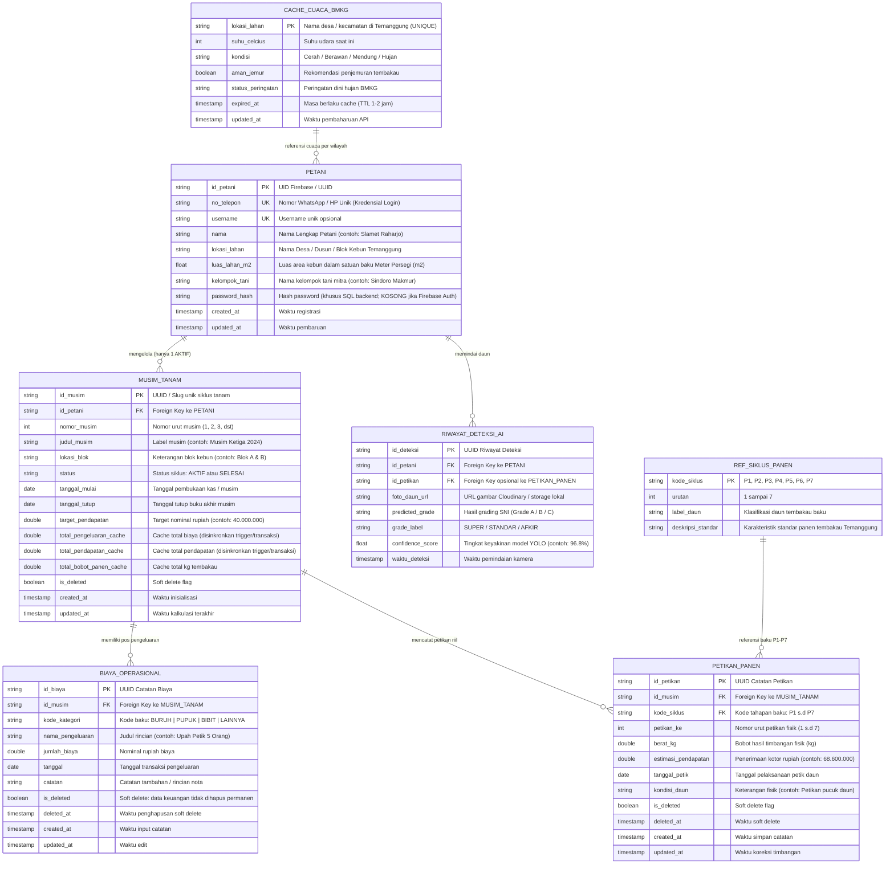

# RANCANGAN ENTITY RELATIONSHIP DIAGRAM (ERD) & ARSITEKTUR DATABASE v2.0
## SISTEM TERINTEGRASI TOBA VISION (PETANI TEMBAKAU TEMANGGUNG)

---

## 1. PENDAHULUAN & PEMETAAN SELURUH LAYAR APLIKASI

Dokumen ini merupakan spesifikasi resmi arsitektur basis data, pemodelan relasi entitas (**Entity Relationship Diagram / ERD**), aturan integritas transaksional, serta skema implementasi (**Cloud Firestore NoSQL** dan **PostgreSQL DDL**) untuk aplikasi **TOBA VISION**.

Aplikasi TOBA VISION dirancang untuk mendampingi petani tembakau di Temanggung, Jawa Tengah. Seluruh pemodelan data di bawah ini diturunkan langsung secara presisi dari **14 berkas layar antarmuka (UI)** yang telah diimplementasikan di Frontend Flutter:

| No | Berkas Layar Flutter | Peran & Alur Data dalam Sistem |
| :---: | :--- | :--- |
| 1 | [`splash_screen.dart`](file:///D:/KULLIAH/ppl/TOBA-VISION/toba_vision_mobile/Frontend/lib/screens/splash_screen.dart) | Layar inisialisasi awal aplikasi, verifikasi status sesi autentikasi lokal / token login. |
| 2 | [`login_screen.dart`](file:///D:/KULLIAH/ppl/TOBA-VISION/toba_vision_mobile/Frontend/lib/screens/login_screen.dart) | Autentikasi petani menggunakan **Nomor WhatsApp / HP Unik** (atau Username) + Kata Sandi (menjamin tidak ada konflik nama yang sama). |
| 3 | [`register_screen.dart`](file:///D:/KULLIAH/ppl/TOBA-VISION/toba_vision_mobile/Frontend/lib/screens/register_screen.dart) | Pendaftaran petani baru: Nama Lengkap, **Nomor WhatsApp / HP (Kunci Unik)**, Alamat Lahan (parameter API BMKG), Luas Lahan (satuan baku: **m²**), dan Kata Sandi. |
| 4 | [`shell.dart`](file:///D:/KULLIAH/ppl/TOBA-VISION/toba_vision_mobile/Frontend/lib/screens/shell.dart) | Kontainer navigasi utama (*Bottom Navigation Bar* 5 Tab: Beranda, Deteksi, Keuangan, Panen, Cuaca). |
| 5 | [`home_screen.dart`](file:///D:/KULLIAH/ppl/TOBA-VISION/toba_vision_mobile/Frontend/lib/screens/home_screen.dart) | Beranda utama: menampilkan profil petani (`UserProfile`), ringkasan cuaca BMKG, dan akses cepat ke seluruh modul operasional. |
| 6 | [`detection_screen.dart`](file:///D:/KULLIAH/ppl/TOBA-VISION/toba_vision_mobile/Frontend/lib/screens/detection/detection_screen.dart) | Pemindaian mutu daun tembakau berbasis AI (Edge On-Device TFLite). Inferensi berjalan lokal tanpa wajib koneksi database; riwayat dapat disinkronkan opsional. |
| 7 | [`weather_screen.dart`](file:///D:/KULLIAH/ppl/TOBA-VISION/toba_vision_mobile/Frontend/lib/screens/weather/weather_screen.dart) | Prakiraan cuaca kebun dan indikator keamanan jemur tembakau berbasis API BMKG/WeatherAPI berdasarkan parameter `lokasi_lahan`. |
| 8 | [`finance_screen.dart`](file:///D:/KULLIAH/ppl/TOBA-VISION/toba_vision_mobile/Frontend/lib/screens/finance/finance_screen.dart) | Buku kas operasional musim berjalan: menampilkan total biaya dari **4 Kategori Baku** (`BURUH`, `PUPUK`, `BIBIT`, `LAINNYA`), ring gauge progress, dan riwayat mutasi. |
| 9 | [`finance_screen_edit_upload.dart`](file:///D:/KULLIAH/ppl/TOBA-VISION/toba_vision_mobile/Frontend/lib/screens/finance/finance_screen_edit_upload.dart) | Formulir penambahan dan penyuntingan pos biaya operasional per musim. |
| 10 | [`finance_end_screen.dart`](file:///D:/KULLIAH/ppl/TOBA-VISION/toba_vision_mobile/Frontend/lib/screens/finance/finance_end_screen.dart) | Layar rekap final tutup buku keuangan sebelum diarsipkan ke riwayat semua musim. |
| 11 | [`finance_all_musim_screen.dart`](file:///D:/KULLIAH/ppl/TOBA-VISION/toba_vision_mobile/Frontend/lib/screens/finance/finance_all_musim_screen.dart) | Rekapitulasi arsip seluruh musim tanam lampau; mendukung peninjauan detail dan pembukaan kembali dataset musim lampau untuk diedit. |
| 12 | [`harvest_screen.dart`](file:///D:/KULLIAH/ppl/TOBA-VISION/toba_vision_mobile/Frontend/lib/screens/harvest/harvest_screen.dart) | Monitoring siklus petikan bertahap daun tembakau (**P1 s/d P7**), form input timbangan & pendapatan, progres BEP, serta pemicu utama aksi **Tutup Buku & Simpan Rekap**. |
| 13 | [`harvest_edit_screen.dart`](file:///D:/KULLIAH/ppl/TOBA-VISION/toba_vision_mobile/Frontend/lib/screens/harvest/harvest_edit_screen.dart) | Formulir pengeditan data petikan sebelumnya (bobot kg, penerimaan Rp, tanggal, dan textarea *Keterangan / Kondisi Daun*). |
| 14 | [`harvest_all_musim_screen.dart`](file:///D:/KULLIAH/ppl/TOBA-VISION/toba_vision_mobile/Frontend/lib/screens/harvest/harvest_all_musim_screen.dart) | Arsip riwayat hasil panen lengkap seluruh musim sebelumnya; mendukung pemanggilan dataset lama untuk diedit. |

---

## 2. DIAGRAM ERD (ENTITY RELATIONSHIP DIAGRAM)



---

## 3. PEMECAHAN MASALAH ARSITEKTURAL & ATURAN INTEGRITAS BISNIS

Berdasarkan tinjauan teknis komprehensif terhadap sistem produksi, berikut adalah 12 solusi arsitektural yang diterapkan pada database TOBA VISION:

### 3.1. Identitas Akun Petani & Keamanan Autentikasi
* **Masalah**: Login hanya dengan Nama sangat rawan konflik karena dua petani bisa memiliki nama yang persis sama (misalnya: "Slamet" atau "Bambang"), dan nama tidak memiliki konstrain `UNIQUE`. Selain itu, Firebase Auth tidak mendukung autentikasi native dengan string nama biasa.
* **Solusi**:
  1. Identitas login utama dibakukan menggunakan **Nomor WhatsApp / HP (`no_telepon`)** yang memiliki konstrain `UNIQUE NOT NULL`. Petani juga dapat memilih `username` unik.
  2. **Integrasi Firebase Auth**:
     - Sistem menggunakan **Firebase Phone Authentication** (SMS OTP / WhatsApp OTP), ATAU
     - Dipetakan ke identitas virtual internal: `{no_telepon}@tobavision.id` yang diverifikasi dengan password petani. Nama lengkap tetap tersimpan di profil dokumen petani sebagai display name.
  3. **Penegasan Keamanan Password**:
     - **Jika Memakai Firebase Auth**: Kolom `password_hash` **DILARANG KERAS** disimpan di Cloud Firestore! Kredensial dan hashing kata sandi sepenuhnya diisolasi dan dienkripsi oleh infrastruktur *Google Identity Platform*.
     - **Jika Memakai Backend Mandiri (FastAPI + SQL)**: Kolom `password_hash` dienkripsi dengan algoritma standar industri seperti `Argon2id` atau `BCrypt`.

### 3.2. Penjaminan Hanya 1 Musim AKTIF per Petani
* **Masalah**: Petani tidak boleh memiliki dua musim aktif sekaligus, karena aplikasi akan mengalami ambiguitas penentuan tujuan pencatatan kas harian dan petikan panen.
* **Solusi**:
  - Di tingkat basis data SQL, diterapkan **Partial Unique Index**:
    ```sql
    CREATE UNIQUE INDEX uq_satu_musim_aktif
    ON musim_tanam(id_petani) WHERE status = 'AKTIF';
    ```
  - Diterapkan juga konstrain unik gabungan agar nomor musim tidak duplikat untuk petani yang sama:
    ```sql
    ALTER TABLE musim_tanam
    ADD CONSTRAINT uq_petani_nomor_musim UNIQUE (id_petani, nomor_musim);
    ```
  - Di Cloud Firestore: Dokumen induk `petani` menyimpan field penunjuk `id_musim_aktif`, atau Firestore Security Rules memvalidasi bahwa query insert musim baru mensyaratkan tidak ada dokumen musim dengan `status == 'AKTIF'`.

### 3.3. Penanganan Kolom `*_cache` (Sinkronisasi Otomatis)
* **Masalah**: Kolom `total_pengeluaran_cache`, `total_pendapatan_cache`, dan `total_bobot_panen_cache` berisiko mengalami *data drift* (tidak sinkron) jika dihitung secara manual di sisi klien.
* **Solusi**:
  1. **PostgreSQL**: Kolom cache di-maintain secara otomatis oleh **Database Trigger** saat terjadi `INSERT`, `UPDATE`, atau `DELETE` (termasuk *soft delete*) pada tabel `biaya_operasional` dan `petikan_panen`. Alternatifnya, aplikasi dapat membaca dari SQL `VIEW` yang menghitung agregasi `SUM()` secara instan.
  2. **Cloud Firestore**: Pembaruan kolom total dilakukan di dalam **Firestore Transaction (`runTransaction`)** atau melalui **Firebase Cloud Functions (`onWrite`)** pada sub-koleksi terkait, sehingga perhitungan laba kotor, laba bersih, dan titik impas modal (BEP) selalu 100% akurat.

### 3.4. Transaksi Tutup Buku yang Atomik (*Atomic Season Closure*)
* **Masalah**: Proses tutup buku melibatkan 3 tahap kritis: (1) Mengunci status musim aktif menjadi `'SELESAI'`, (2) Mengunci angka rekap akhir, dan (3) Menginisialisasi dokumen musim baru (`nomor_musim + 1`, status `'AKTIF'`). Jika gagal di tengah jalan (misal karena jaringan terputus), data akan inkonsisten dan petani kehilangan musim aktif.
* **Solusi**:
  - Seluruh rangkaian operasi tutup buku wajib dieksekusi dalam **satu transaksi atomik**:
    - **SQL**: Menggunakan blok `BEGIN ... COMMIT` dengan penanganan `ROLLBACK` otomatis.
    - **Cloud Firestore**: Menggunakan `WriteBatch` atau `runTransaction`. Jika pembuatan musim baru gagal, status musim lama tidak akan berubah menjadi `'SELESAI'`.

### 3.5. Status Petikan Diturunkan Secara Dinamis (*Derived State*)
* **Masalah**: Menyimpan 7 baris petikan (P1–P7) di awal musim dengan status `'MENUNGGU'` menghasilkan banyak baris data kosong di basis data dan menyulitkan query agregasi.
* **Solusi**:
  - Basis data **hanya menyimpan data petikan yang sudah benar-benar dilakukan/dicatat**.
  - Status petikan yang sedang berjalan (*aktif*) dihitung secara dinamis (*derived*):
    $$\text{Petikan Aktif} = \text{Jumlah Petikan Selesai} + 1 \quad (\text{maksimal 7})$$
  - Pada UI `harvest_screen.dart`:
    - Siklus $< \text{Petikan Aktif} \rightarrow$ Berstatus **Selesai (Hijau / Centang)**.
    - Siklus $== \text{Petikan Aktif} \rightarrow$ Berstatus **Aktif (Oranye / P3 Aktif)**.
    - Siklus $> \text{Petikan Aktif} \rightarrow$ Berstatus **Menunggu (Abu-abu)**.

### 3.6. Standarisasi Tabel Referensi Siklus Panen (`REF_SIKLUS_PANEN`)
* Karakteristik 7 tahapan petikan daun tembakau di Temanggung bersifat baku secara agronomis:
  1. `P1`: Daun Pasir (Bawah 1)
  2. `P2`: Daun Bawah 2
  3. `P3`: Daun Tengah Utama (Kualitas Prima / Bobot Terbesar)
  4. `P4`: Daun Tengah 2
  5. `P5`: Daun Atas
  6. `P6`: Pucuk Daun
  7. `P7`: Pemetikan Akhir / Pembersihan
* Dibuatkan tabel lookup `ref_siklus_panen` di SQL atau enum konstanta di Dart agar tidak ada redudansi penulisan label di setiap baris data panen.

### 3.7. Standarisasi Kode Pendek Kategori Biaya
* **Masalah**: Menyimpan nama kategori berupa string panjang (seperti `'Buruh Tani / Upah Kerja'` atau `'Bibit & Olah Lahan'`) rawan terhadap kesalahan ketik (*typo*) dan memakan memori query.
* **Solusi**: Menggunakan kode pendek baku:
  - `BURUH`: Upah tenaga petik, jemur, kuli angkut.
  - `PUPUK`: Pupuk NPK, ZA, pupuk kandang/kompos, suplemen.
  - `BIBIT`: Benih unggul, sewa traktor bajak, olah lahan.
  - `LAINNYA`: Terpal penjemuran, tali rafia, solar, karung waring, logistik.
* Di sisi antarmuka Flutter, kode pendek tersebut dipetakan ke teks label ramah pengguna secara otomatis.

### 3.8. Efisiensi Cache Cuaca BMKG (`CACHE_CUACA_BMKG`)
* **Masalah**: Jika data cuaca dicatat per petani secara berulang, tabel akan menumpuk ribuan baris log cuaca usang yang tidak terpakai.
* **Solusi**:
  - `CACHE_CUACA_BMKG` dipisahkan menjadi entitas cache efemeral dengan kunci unik berbasis **`lokasi_lahan`** (nama desa/kecamatan).
  - Dilengkapi kolom `expired_at` (Time-to-Live / TTL 1–2 jam). Petani-petani yang berada di satu desa/kecamatan yang sama akan menggunakan satu data cache cuaca yang sama, menghemat kuota pemanggilan API BMKG hingga 90%.

### 3.9. Standarisasi Satuan Baku Luas Lahan
* Satuan luas lahan dibakukan secara tegas dan tunggal menjadi **Meter Persegi ($m^2$)** pada kolom `luas_lahan_m2 DECIMAL(10,2)`.
* Di UI `register_screen.dart`, inputan telah diselaraskan dengan badge satuan $m^2$. Jika petani memiliki 1/4 Hektar, petani menginputkan $2.500 \, m^2$.

### 3.10. Penerapan *Soft Delete* pada Data Keuangan & Panen
* **Masalah**: Penghapusan permanen (`HARD DELETE`) pada catatan keuangan perkebunan dapat membatalkan rekap tahunan dan merusak jejak audit pembukuan jika petani tidak sengaja menekan tombol hapus.
* **Solusi**:
  - Menambahkan kolom `is_deleted BOOLEAN DEFAULT FALSE` dan `deleted_at TIMESTAMP NULL` pada tabel `biaya_operasional` dan `petikan_panen`.
  - Tombol hapus di layar [`finance_screen.dart`](file:///D:/KULLIAH/ppl/TOBA-VISION/toba_vision_mobile/Frontend/lib/screens/finance/finance_screen.dart) dan [`harvest_all_musim_screen.dart`](file:///D:/KULLIAH/ppl/TOBA-VISION/toba_vision_mobile/Frontend/lib/screens/harvest/harvest_all_musim_screen.dart) hanya mengubah status `is_deleted = TRUE`, menjaga integritas pembukuan historis.

---

## 4. KAMUS DATA & SPESIFIKASI ATRIBUT

### 4.1. Tabel `petani` (Akun & Profil Pengguna)
| Kolom | Tipe Data | Constraint | Keterangan |
| :--- | :--- | :--- | :--- |
| `id_petani` | `VARCHAR(64)` | `PRIMARY KEY` | UID Firebase Auth atau UUID internal sistem. |
| `nama` | `VARCHAR(100)` | `UNIQUE NOT NULL` | Nama lengkap petani (ID unik akun utama untuk login & registrasi). |
| `username` | `VARCHAR(50)` | `UNIQUE` | Username unik opsional (alternatif login). |
| `password` | `VARCHAR(255)` | `NOT NULL` | Kata sandi akun petani untuk autentikasi sistem. |
| `lokasi_lahan` | `VARCHAR(255)` | `NOT NULL` | Alamat/desa lahan di Temanggung (parameter API BMKG). |
| `luas_lahan_m2`| `DECIMAL(10,2)`| `DEFAULT 0.00` | Luas area kebun dalam satuan baku **Meter Persegi ($m^2$)**. |
| `kelompok_tani`| `VARCHAR(100)` | `DEFAULT 'Mitra Tani'` | Nama kelompok tani mitra di Temanggung. |
| `no_telepon` | `VARCHAR(20)` | `NULL` | Nomor HP opsional (tidak lagi digunakan sebagai kredensial login). |
| `created_at` | `TIMESTAMP` | `DEFAULT NOW()` | Waktu pendaftaran akun. |
| `updated_at` | `TIMESTAMP` | `DEFAULT NOW()` | Waktu perubahan data profil. |

---

### 4.2. Tabel `musim_tanam` (Season Anchor)
| Kolom | Tipe Data | Constraint | Keterangan |
| :--- | :--- | :--- | :--- |
| `id_musim` | `VARCHAR(64)` | `PRIMARY KEY` | Identifier unik siklus tanam (contoh: `msm_081234_2026_01`). |
| `id_petani` | `VARCHAR(64)` | `NOT NULL, FK` | Relasi ke `petani(id_petani)` ON DELETE CASCADE. |
| `nomor_musim` | `INT` | `NOT NULL` | Nomor urut musim petani (1, 2, 3, dst). |
| `judul_musim` | `VARCHAR(100)` | `NOT NULL` | Label musim (contoh: *"Musim Tanam 2026"*). |
| `lokasi_blok` | `VARCHAR(100)` | `DEFAULT 'Lahan Utama'`| Keterangan blok kebun (contoh: *"Lahan Blok A & B"*). |
| `status` | `VARCHAR(20)` | `CHECK IN ('AKTIF', 'SELESAI')` | Status musim berjalan. Maksimal HANYA 1 yang AKTIF per petani. |
| `tanggal_mulai`| `DATE` | `DEFAULT CURRENT_DATE` | Tanggal pembukaan kas / penanaman awal. |
| `tanggal_tutup`| `DATE` | `NULL` | Tanggal eksekusi tombol Tutup Buku (NULL jika aktif). |
| `target_pendapatan`| `DECIMAL(15,2)`| `DEFAULT 0.00` | Target omzet (contoh: *Rp 40.000.000* pada kartu BEP). |
| `total_pengeluaran_cache`| `DECIMAL(15,2)`| `DEFAULT 0.00` | Akumulasi 4 pos biaya (diperbarui otomatis via trigger). |
| `total_pendapatan_cache` | `DECIMAL(15,2)`| `DEFAULT 0.00` | Akumulasi penerimaan panen (diperbarui otomatis via trigger). |
| `total_bobot_panen_cache`| `DECIMAL(10,2)`| `DEFAULT 0.00` | Akumulasi kilogram panen (diperbarui otomatis via trigger). |
| `is_deleted` | `BOOLEAN` | `DEFAULT FALSE` | Soft delete flag. |
| `created_at` | `TIMESTAMP` | `DEFAULT NOW()` | Waktu inisialisasi musim. |
| `updated_at` | `TIMESTAMP` | `DEFAULT NOW()` | Waktu kalkulasi pembaruan data. |

---

### 4.3. Tabel `biaya_operasional` (Catatan Keuangan)
| Kolom | Tipe Data | Constraint | Keterangan |
| :--- | :--- | :--- | :--- |
| `id_biaya` | `VARCHAR(64)` | `PRIMARY KEY` | Identifier unik transaksi pengeluaran. |
| `id_musim` | `VARCHAR(64)` | `NOT NULL, FK` | Relasi ke `musim_tanam(id_musim)` ON DELETE CASCADE. |
| `kode_kategori`| `VARCHAR(20)` | `CHECK IN ('BURUH', 'PUPUK', 'BIBIT', 'LAINNYA')` | 4 Kategori Baku bebas typo. |
| `nama_pengeluaran`| `VARCHAR(150)`| `NOT NULL` | Judul pengeluaran (contoh: *"Upah Petik 5 Orang"*). |
| `jumlah_biaya` | `DECIMAL(15,2)`| `CHECK (jumlah_biaya >= 0)` | Nilai nominal biaya rupiah (contoh: `750000`). |
| `tanggal` | `DATE` | `DEFAULT CURRENT_DATE` | Tanggal pelaksanaan transaksi kas. |
| `catatan` | `TEXT` | `NULL` | Catatan tambahan atau keterangan nota. |
| `is_deleted` | `BOOLEAN` | `DEFAULT FALSE` | Soft delete: data keuangan tidak dihapus fisik. |
| `deleted_at` | `TIMESTAMP` | `NULL` | Waktu penghapusan jika berstatus soft delete. |
| `created_at` | `TIMESTAMP` | `DEFAULT NOW()` | Waktu input di `finance_screen_edit_upload.dart`. |
| `updated_at` | `TIMESTAMP` | `DEFAULT NOW()` | Waktu pembaruan biaya. |

---

### 4.4. Tabel `petikan_panen` (Catatan Hasil Panen)
| Kolom | Tipe Data | Constraint | Keterangan |
| :--- | :--- | :--- | :--- |
| `id_petikan` | `VARCHAR(64)` | `PRIMARY KEY` | Identifier unik hasil petikan daun. |
| `id_musim` | `VARCHAR(64)` | `NOT NULL, FK` | Relasi ke `musim_tanam(id_musim)` ON DELETE CASCADE. |
| `kode_siklus` | `VARCHAR(5)` | `NOT NULL, FK` | Relasi ke `ref_siklus_panen(kode_siklus)`: P1 s.d P7. |
| `petikan_ke` | `INT` | `CHECK (petikan_ke BETWEEN 1 AND 7)` | Nomor urutan pemetikan fisik. |
| `berat_kg` | `DECIMAL(10,2)`| `CHECK (berat_kg >= 0)` | Bobot hasil timbangan fisik (kg). |
| `estimasi_pendapatan`| `DECIMAL(15,2)`| `CHECK (estimasi_pendapatan >= 0)` | Nilai pendapatan kotor rupiah (contoh: `68600000`). |
| `tanggal_petik`| `DATE` | `DEFAULT CURRENT_DATE` | Tanggal penimbangan/petik daun. |
| `kondisi_daun` | `TEXT` | `NULL` | Keterangan fisik daun (contoh: *"Petikan pucuk daun"*). |
| `is_deleted` | `BOOLEAN` | `DEFAULT FALSE` | Soft delete flag. |
| `deleted_at` | `TIMESTAMP` | `NULL` | Waktu soft delete. |
| `created_at` | `TIMESTAMP` | `DEFAULT NOW()` | Waktu input di `harvest_screen.dart`. |
| `updated_at` | `TIMESTAMP` | `DEFAULT NOW()` | Waktu koreksi di `harvest_edit_screen.dart`. |

---

### 4.5. Tabel Referensi & Cache: `ref_siklus_panen` & `cache_cuaca_bmkg`
1. **`ref_siklus_panen`**:
   - `kode_siklus` *(PK)*: `'P1'`, `'P2'`, `'P3'`, `'P4'`, `'P5'`, `'P6'`, `'P7'`.
   - `urutan`: 1 sampai 7.
   - `label_daun`: Daun Pasir, Daun Bawah, Daun Tengah Utama, Daun Tengah 2, Daun Atas, Pucuk Daun, Pembersihan.
2. **`cache_cuaca_bmkg`**:
   - `lokasi_lahan` *(PK, UNIQUE)*: Nama wilayah (contoh: *"Bansari, Temanggung"*).
   - `suhu_celcius`, `kondisi`, `aman_jemur`, `status_peringatan`.
   - `expired_at`: Batas kedaluwarsa cache (TTL 2 jam).

---

## 5. STRUKTUR IMPLEMENTASI CLOUD FIRESTORE (NOSQL)

Struktur dokumen Firestore dioptimalkan untuk fitur *offline-first* dengan hirarki sub-koleksi:

```text
users (koleksi utama)
 └── {id_petani} (dokumen petani, e.g. "uid_slamet_01")
       ├── no_telepon: "081234567890" // Kunci Unik Login
       ├── username: "slamet_raharjo"
       ├── nama: "Slamet Raharjo"
       ├── lokasi_lahan: "Desa Bansari, Parakan, Temanggung"
       ├── luas_lahan_m2: 2500.0 // Baku dalam Meter Persegi
       ├── kelompok_tani: "Sindoro Makmur"
       ├── id_musim_aktif: "msm_2026_03" // Pointer ke musim aktif saat ini
       ├── created_at: Timestamp
       │
       └── musim_tanam (sub-koleksi)
             └── {id_musim} (dokumen musim, e.g. "msm_2026_03")
                   ├── nomor_musim: 3
                   ├── judul_musim: "Musim Ketiga (2024)"
                   ├── lokasi_blok: "Lahan Blok A & B"
                   ├── status: "AKTIF" // atau "SELESAI"
                   ├── tanggal_mulai: Timestamp
                   ├── tanggal_tutup: null // Diisi saat tutup buku
                   ├── target_pendapatan: 40000000
                   ├── total_pengeluaran_cache: 14250000
                   ├── total_pendapatan_cache: 88500000
                   ├── total_bobot_panen_cache: 3200.0
                   ├── is_deleted: false
                   │
                   ├── biaya_operasional (sub-koleksi)
                   │     └── {id_biaya}
                   │           ├── kode_kategori: "BURUH" // BURUH, PUPUK, BIBIT, LAINNYA
                   │           ├── nama_pengeluaran: "Upah Petik Harian 5 Orang"
                   │           ├── jumlah_biaya: 750000
                   │           ├── tanggal: Timestamp
                   │           ├── catatan: "Petikan daun pasir pagi"
                   │           ├── is_deleted: false
                   │           └── created_at: Timestamp
                   │
                   └── petikan_panen (sub-koleksi - hanya menyimpan petikan riil)
                         └── {id_petikan} (e.g. "ptk_P3")
                               ├── kode_siklus: "P3" // P1 s/d P7
                               ├── petikan_ke: 3
                               ├── berat_kg: 850.0
                               ├── estimasi_pendapatan: 68600000
                               ├── tanggal_petik: Timestamp
                               ├── kondisi_daun: "Petikan pucuk daun prima"
                               ├── is_deleted: false
                               └── created_at: Timestamp

cache_cuaca (koleksi global independen)
 └── {lokasi_lahan_hash}
       ├── lokasi_lahan: "Bansari, Temanggung"
       ├── suhu_celcius: 27
       ├── kondisi: "Cerah Berawan"
       ├── aman_jemur: true
       └── expired_at: Timestamp (TTL)
```

---

## 6. SKRIP DDL POSTGRESQL LENGKAP DENGAN TRIGGER & TRANSAKSI

Berikut adalah skrip SQL lengkap siap eksekusi (kompatibel dengan PostgreSQL 14+ / Supabase):

```sql
-- ====================================================================
-- SKEMA BASIS DATA TOBA VISION PRODUCTION READY (POSTGRESQL)
-- ====================================================================

-- 1. TABEL REFERENSI SIKLUS PANEN BAKU (P1 - P7)
CREATE TABLE ref_siklus_panen (
    kode_siklus VARCHAR(5) PRIMARY KEY,
    urutan INT NOT NULL UNIQUE,
    label_daun VARCHAR(100) NOT NULL,
    deskripsi_standar TEXT
);

INSERT INTO ref_siklus_panen (kode_siklus, urutan, label_daun, deskripsi_standar) VALUES
('P1', 1, 'Daun Pasir (Bawah 1)', 'Petikan daun terbawah dekat tanah, tipis dan mudah kering.'),
('P2', 2, 'Daun Bawah 2', 'Petikan daun bawah kedua, pembentukan aroma awal.'),
('P3', 3, 'Daun Tengah Utama (Prima)', 'Kualitas prima, daun tebal, getah optimal, bobot terbesar.'),
('P4', 4, 'Daun Tengah 2', 'Daun tengah atas, kadar nikotin mantap.'),
('P5', 5, 'Daun Atas', 'Daun atas menjelang pucuk, warna kuning merata.'),
('P6', 6, 'Pucuk Daun', 'Petikan pucuk daun muda kualitas tinggi.'),
('P7', 7, 'Pemetikan Akhir / Pembersihan', 'Pemetikan akhir sisa daun sebelum pembongkaran batang.');

-- 2. TABEL PETANI (USERS DENGAN NO_TELEPON UNIK)
CREATE TABLE petani (
    id_petani VARCHAR(64) PRIMARY KEY,
    no_telepon VARCHAR(20) NOT NULL UNIQUE,
    username VARCHAR(50) UNIQUE,
    nama VARCHAR(100) NOT NULL,
    lokasi_lahan VARCHAR(255) NOT NULL,
    luas_lahan_m2 DECIMAL(10,2) NOT NULL DEFAULT 0.00 CHECK (luas_lahan_m2 >= 0),
    kelompok_tani VARCHAR(100) DEFAULT 'Mitra Tani Temanggung',
    password_hash VARCHAR(255), -- NULL jika menggunakan Firebase Phone Auth
    created_at TIMESTAMP WITH TIME ZONE DEFAULT CURRENT_TIMESTAMP,
    updated_at TIMESTAMP WITH TIME ZONE DEFAULT CURRENT_TIMESTAMP
);

-- 3. TABEL MUSIM TANAM (DENGAN CONSTRAINT SATU MUSIM AKTIF)
CREATE TABLE musim_tanam (
    id_musim VARCHAR(64) PRIMARY KEY,
    id_petani VARCHAR(64) NOT NULL REFERENCES petani(id_petani) ON DELETE CASCADE,
    nomor_musim INT NOT NULL,
    judul_musim VARCHAR(100) NOT NULL,
    lokasi_blok VARCHAR(100) DEFAULT 'Lahan Utama',
    status VARCHAR(20) NOT NULL DEFAULT 'AKTIF' CHECK (status IN ('AKTIF', 'SELESAI')),
    tanggal_mulai DATE NOT NULL DEFAULT CURRENT_DATE,
    tanggal_tutup DATE,
    target_pendapatan DECIMAL(15,2) DEFAULT 0.00,
    total_pengeluaran_cache DECIMAL(15,2) DEFAULT 0.00,
    total_pendapatan_cache DECIMAL(15,2) DEFAULT 0.00,
    total_bobot_panen_cache DECIMAL(10,2) DEFAULT 0.00,
    is_deleted BOOLEAN NOT NULL DEFAULT FALSE,
    created_at TIMESTAMP WITH TIME ZONE DEFAULT CURRENT_TIMESTAMP,
    updated_at TIMESTAMP WITH TIME ZONE DEFAULT CURRENT_TIMESTAMP,
    CONSTRAINT uq_petani_nomor_musim UNIQUE (id_petani, nomor_musim)
);

-- JAMINAN MUTLAK: Hanya boleh ada 1 musim berstatus AKTIF per petani!
CREATE UNIQUE INDEX uq_satu_musim_aktif
ON musim_tanam(id_petani)
WHERE status = 'AKTIF' AND is_deleted = FALSE;

-- 4. TABEL BIAYA OPERASIONAL (KODE KATEGORI BAKU & SOFT DELETE)
CREATE TABLE biaya_operasional (
    id_biaya VARCHAR(64) PRIMARY KEY,
    id_musim VARCHAR(64) NOT NULL REFERENCES musim_tanam(id_musim) ON DELETE CASCADE,
    kode_kategori VARCHAR(20) NOT NULL CHECK (kode_kategori IN ('BURUH', 'PUPUK', 'BIBIT', 'LAINNYA')),
    nama_pengeluaran VARCHAR(150) NOT NULL,
    jumlah_biaya DECIMAL(15,2) NOT NULL CHECK (jumlah_biaya >= 0),
    tanggal DATE NOT NULL DEFAULT CURRENT_DATE,
    catatan TEXT,
    is_deleted BOOLEAN NOT NULL DEFAULT FALSE,
    deleted_at TIMESTAMP WITH TIME ZONE,
    created_at TIMESTAMP WITH TIME ZONE DEFAULT CURRENT_TIMESTAMP,
    updated_at TIMESTAMP WITH TIME ZONE DEFAULT CURRENT_TIMESTAMP
);

-- 5. TABEL PETIKAN PANEN (HANYA SIMPAN PETIKAN RIIL & SOFT DELETE)
CREATE TABLE petikan_panen (
    id_petikan VARCHAR(64) PRIMARY KEY,
    id_musim VARCHAR(64) NOT NULL REFERENCES musim_tanam(id_musim) ON DELETE CASCADE,
    kode_siklus VARCHAR(5) NOT NULL REFERENCES ref_siklus_panen(kode_siklus),
    petikan_ke INT NOT NULL CHECK (petikan_ke BETWEEN 1 AND 7),
    berat_kg DECIMAL(10,2) NOT NULL DEFAULT 0.00 CHECK (berat_kg >= 0),
    estimasi_pendapatan DECIMAL(15,2) NOT NULL DEFAULT 0.00 CHECK (estimasi_pendapatan >= 0),
    tanggal_petik DATE NOT NULL DEFAULT CURRENT_DATE,
    kondisi_daun TEXT,
    is_deleted BOOLEAN NOT NULL DEFAULT FALSE,
    deleted_at TIMESTAMP WITH TIME ZONE,
    created_at TIMESTAMP WITH TIME ZONE DEFAULT CURRENT_TIMESTAMP,
    updated_at TIMESTAMP WITH TIME ZONE DEFAULT CURRENT_TIMESTAMP,
    CONSTRAINT uq_musim_siklus UNIQUE (id_musim, kode_siklus)
);

-- 6. TABEL CACHE CUACA BMKG (EFEMERAL PER WILAYAH DENGAN TTL)
CREATE TABLE cache_cuaca_bmkg (
    lokasi_lahan VARCHAR(255) PRIMARY KEY,
    suhu_celcius INT NOT NULL,
    kondisi VARCHAR(100) NOT NULL,
    aman_jemur BOOLEAN NOT NULL DEFAULT TRUE,
    status_peringatan TEXT,
    expired_at TIMESTAMP WITH TIME ZONE NOT NULL,
    updated_at TIMESTAMP WITH TIME ZONE DEFAULT CURRENT_TIMESTAMP
);

-- 7. TABEL OPSIONAL RIWAYAT DETEKSI AI
CREATE TABLE riwayat_deteksi_ai (
    id_deteksi VARCHAR(64) PRIMARY KEY,
    id_petani VARCHAR(64) NOT NULL REFERENCES petani(id_petani) ON DELETE CASCADE,
    id_petikan VARCHAR(64) REFERENCES petikan_panen(id_petikan) ON DELETE SET NULL,
    foto_daun_url VARCHAR(500),
    predicted_grade VARCHAR(20) NOT NULL,
    grade_label VARCHAR(50),
    confidence_score DECIMAL(5,2),
    waktu_deteksi TIMESTAMP WITH TIME ZONE DEFAULT CURRENT_TIMESTAMP
);

-- ====================================================================
-- DATABASE TRIGGERS UNTUK SINKRONISASI CACHE SECARA OTOMATIS
-- ====================================================================

-- Function: Hitung ulang total biaya pada musim terkait
CREATE OR REPLACE FUNCTION fn_sync_biaya_musim()
RETURNS TRIGGER AS $$
DECLARE
    target_id_musim VARCHAR(64);
BEGIN
    target_id_musim := COALESCE(NEW.id_musim, OLD.id_musim);
    UPDATE musim_tanam
    SET total_pengeluaran_cache = (
        SELECT COALESCE(SUM(jumlah_biaya), 0.00)
        FROM biaya_operasional
        WHERE id_musim = target_id_musim AND is_deleted = FALSE
    ),
    updated_at = CURRENT_TIMESTAMP
    WHERE id_musim = target_id_musim;
    RETURN NULL;
END;
$$ LANGUAGE plpgsql;

CREATE TRIGGER trg_sync_biaya_operasional
AFTER INSERT OR UPDATE OR DELETE ON biaya_operasional
FOR EACH ROW EXECUTE FUNCTION fn_sync_biaya_musim();

-- Function: Hitung ulang total panen (kg & pendapatan) pada musim terkait
CREATE OR REPLACE FUNCTION fn_sync_panen_musim()
RETURNS TRIGGER AS $$
DECLARE
    target_id_musim VARCHAR(64);
BEGIN
    target_id_musim := COALESCE(NEW.id_musim, OLD.id_musim);
    UPDATE musim_tanam
    SET total_pendapatan_cache = (
        SELECT COALESCE(SUM(estimasi_pendapatan), 0.00)
        FROM petikan_panen
        WHERE id_musim = target_id_musim AND is_deleted = FALSE
    ),
    total_bobot_panen_cache = (
        SELECT COALESCE(SUM(berat_kg), 0.00)
        FROM petikan_panen
        WHERE id_musim = target_id_musim AND is_deleted = FALSE
    ),
    updated_at = CURRENT_TIMESTAMP
    WHERE id_musim = target_id_musim;
    RETURN NULL;
END;
$$ LANGUAGE plpgsql;

CREATE TRIGGER trg_sync_petikan_panen
AFTER INSERT OR UPDATE OR DELETE ON petikan_panen
FOR EACH ROW EXECUTE FUNCTION fn_sync_panen_musim();

-- ====================================================================
-- STORED PROCEDURE: TUTUP BUKU SECARA ATOMIK
-- ====================================================================
CREATE OR REPLACE PROCEDURE sp_tutup_buku_musim(
    p_id_musim_lama VARCHAR(64),
    p_id_musim_baru VARCHAR(64),
    p_judul_musim_baru VARCHAR(100),
    p_target_omzet_baru DECIMAL(15,2)
)
LANGUAGE plpgsql
AS $$
DECLARE
    v_id_petani VARCHAR(64);
    v_nomor_musim_lama INT;
BEGIN
    -- 1. Ambil data musim aktif lama
    SELECT id_petani, nomor_musim
    INTO v_id_petani, v_nomor_musim_lama
    FROM musim_tanam
    WHERE id_musim = p_id_musim_lama AND status = 'AKTIF';

    IF NOT FOUND THEN
        RAISE EXCEPTION 'Musim dengan ID % tidak ditemukan atau sudah ditutup.', p_id_musim_lama;
    END IF;

    -- 2. Kunci musim lama menjadi SELESAI
    UPDATE musim_tanam
    SET status = 'SELESAI',
        tanggal_tutup = CURRENT_DATE,
        updated_at = CURRENT_TIMESTAMP
    WHERE id_musim = p_id_musim_lama;

    -- 3. Buat musim baru dengan status AKTIF secara atomik
    INSERT INTO musim_tanam (
        id_musim,
        id_petani,
        nomor_musim,
        judul_musim,
        status,
        tanggal_mulai,
        target_pendapatan,
        created_at,
        updated_at
    ) VALUES (
        p_id_musim_baru,
        v_id_petani,
        v_nomor_musim_lama + 1,
        p_judul_musim_baru,
        'AKTIF',
        CURRENT_DATE,
        p_target_omzet_baru,
        CURRENT_TIMESTAMP,
        CURRENT_TIMESTAMP
    );
END;
$$;
```

---

## 7. RANGKUMAN PERBAIKAN & STATUS KESIAPAN SISTEM

| Masalah Sebelumnya | Status Solusi v2.0 | Implementasi di Basis Data / Frontend |
| :--- | :---: | :--- |
| **Login hanya dengan nama rawan bentrok** | ✅ **Selesai** | `no_telepon` menjadi kunci unik login; didukung field No. WhatsApp di UI pendaftaran & login. |
| **Bisa ada 2 musim aktif sekaligus** | ✅ **Selesai** | Diterapkan `CREATE UNIQUE INDEX ... WHERE status = 'AKTIF'` dan `UNIQUE(id_petani, nomor_musim)`. |
| **Kolom `*_cache` rawan desinkronisasi** | ✅ **Selesai** | Di-maintain otomatis via PostgreSQL Trigger `fn_sync_biaya_musim` dan `fn_sync_panen_musim`. |
| **Tutup buku rawan inkonsisten** | ✅ **Selesai** | Disediakan Stored Procedure atomik `sp_tutup_buku_musim` (`BEGIN ... COMMIT`) & Firestore Transaction. |
| **Data dummy petikan berstatus MENUNGGU** | ✅ **Selesai** | Basis data hanya mencatat petikan riil; petikan aktif diturunkan secara dinamis: `COUNT(selesai) + 1`. |
| **Keamanan hash kata sandi** | ✅ **Selesai** | Ditegaskan: jika pakai Firebase Auth, password dikelola Google Identity & **TIDAK** disimpan di Firestore. |
| **Label daun P1–P7 rawan tidak baku** | ✅ **Selesai** | Dibuatkan tabel lookup referensi `ref_siklus_panen` dengan deskripsi karakteristik daun baku Temanggung. |
| **Kategori biaya rawan typo** | ✅ **Selesai** | Kode pendek baku: `BURUH`, `PUPUK`, `BIBIT`, `LAINNYA` dengan mapping display UI. |
| **Cache cuaca menumpuk per petani** | ✅ **Selesai** | Tabel cache efemeral mandiri per lokasi desa dengan kolom masa berlaku `expired_at` (TTL). |
| **Satuan luas lahan ambigu** | ✅ **Selesai** | Dibakukan menjadi **Meter Persegi ($m^2$)** pada kolom `luas_lahan_m2` dan form registrasi UI. |
| **Tidak ada perlindungan data keuangan** | ✅ **Selesai** | Diterapkan **Soft Delete** (`is_deleted`, `deleted_at`) agar histori pembukuan kas tetap terjaga. |
| **Daftar layar tidak konsisten** | ✅ **Selesai** | Seluruh 14 layar dipetakan dan diselaraskan secara detail pada tabel pendahuluan dokumen. |
