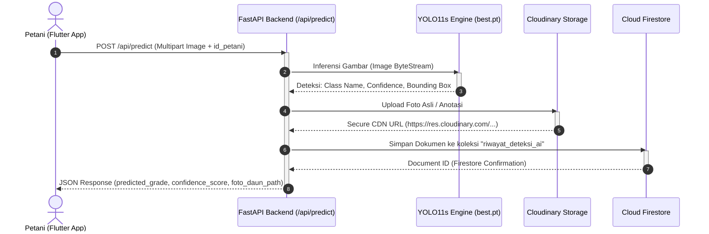

# 🍃 RANCANGAN ARSITEKTUR & STRATEGI TRAINING DATASET YOLO
## SISTEM DETEKSI & GRADING MUTU DAUN TEMBAKAU (TOBA VISION)
**Versi Dokumen:** 2.0  
**Target Platform:** Roboflow Universe • Ultralytics YOLO11 • FastAPI Backend • Flutter Mobile  
**Dataset Rujukan:** [Roboflow Universe - Tobacco Grader v1n6p](https://universe.roboflow.com/tobacco-grades/tobacco-grader-v1n6p/browse?queryText=&pageSize=100&startingIndex=0&browseQuery=true)  
**Lingkungan Kerja:** `toba_vision_mobile/Backend`  

---

## 1. PENDAHULUAN & LATAR BELAKANG MASALAH

### 1.1 Permasalahan Model Sebelumnya (`best.pt`)
Model sebelumnya yang terpasang di backend (`toba_vision_mobile/Backend/models/best.pt`) memiliki spesifikasi teknis:
* **Arsitektur:** `YOLO11n-cls` (YOLO11 Nano Classification)
* **Ukuran Model:** 3.19 MB (1.534.947 parameter)
* **Kelas Asli:** `Immature`, `Mature`, `Overripe`
* **Penyebab Utama Akurasi Rendah:**
  1. **Kapasitas Model Terlalu Rendah (*Underfitting*):** Arsitektur varian *Nano* (`n`) dirancang untuk edge device ultra-rendah dan sering gagal menangkap perbedaan gradasi halus (*subtle color gradients*) antara daun hijau matang sempurna dan daun setengah matang pada kondisi pencahayaan dinamis di perkebunan.
  2. **Inkonsistensi Variasi Pencahayaan:** Tanpa augmentasi kontras dan rentang kecerahan yang tepat, model mudah terkecoh oleh bayangan tubuh petani, pantulan sinar matahari terik (*overexposure*), atau latar belakang sasak jemuran.
  3. **Keterbatasan Task Classification Penuh:** Model klasifikasi satu gambar penuh (*whole-image classification*) mengambil rata-rata piksel seluruh frame, sehingga apabila terdapat latar belakang tanah/bambu yang dominan, fitur daun menjadi terdistorsi.

### 1.2 Tujuan Rancangan Baru
1. Mengganti model lama dengan arsitektur **YOLO11 Small (`yolo11s`)** yang memiliki kapasitas representasi fitur warna dan tekstur daun jauh lebih kaya.
2. Mengadopsi dataset terstandarisasi industri dari Roboflow Universe: **Tobacco Grader v1n6p**.
3. Menyelaraskan output deteksi langsung ke standar klasifikasi mutu tembakau: **Grade A (Bagus)**, **Grade B (Sedang)**, dan **Grade C (Jelek / Afkir)**.
4. Menyediakan dokumen komprehensif siap pakai untuk dieksekusi langsung oleh **Claude AI** guna pembuatan skrip training, evaluasi metrik, dan integrasi backend.

---

## 2. SPESIFIKASI DATASET: TOBACCO GRADER (v1n6p)

### 2.1 Metadata Dataset
* **Nama Project Roboflow:** `tobacco-grader-v1n6p`
* **Workspace:** `tobacco-grades`
* **URL Dataset:** [https://universe.roboflow.com/tobacco-grades/tobacco-grader-v1n6p](https://universe.roboflow.com/tobacco-grades/tobacco-grader-v1n6p)
* **Total Sampel Gambar:** ~583 citra daun tembakau beranotasi
* **Format Task Utama:** Object Detection (Bounding Box) & Single/Multi-label Quality Evaluation
* **Lisensi Dataset:** Open Source / Creative Commons (CC BY 4.0)

### 2.2 Taksonomi Kelas & Pemetaan Mutu (*Class Taxonomy*)

Sistem mengadopsi 3 kelas klasifikasi mutu industri tembakau:

| ID Kelas | Label Asli Roboflow | Label Target Backend | Kategori Mutu | Ciri-Ciri Morfologi & Visual Daun |
| :---: | :--- | :--- | :--- | :--- |
| **0** | `High Quality` | `Grade A` | **Bagus / Prima** | • Warna hijau kekuningan cerah merata (*golden green*) atau kuning keemasan.<br>• Permukaan mengkilap dengan getah minyak alami (*resinous*).<br>• Tidak ada lubang ulat/hama, tidak ada bercak penyakit.<br>• Ujung daun melengkung proporsional (matang optimal). |
| **1** | `Medium Quality` | `Grade B` | **Sedang / Standar** | • Warna hijau agak pekat (mentah) atau warna belang-belang.<br>• Terdapat sedikit bercak kecil (<10% area daun) atau sedikit kerutan.<br>• Minyak tembakau belum optimal.<br>• Daun petikan bawah atau daun yang sedikit terlambat dipetik. |
| **2** | `Low Quality` | `Grade C` | **Jelek / Afkir** | • Warna cokelat tua gelap, kehitaman, gosong terbakar matahari, atau kusam.<br>• Terdapat infeksi penyakit (bercak *Cercospora*, virus mosaik, jamur putih).<br>• Daun robek parah, bolong kena hama, atau membusuk terkena air hujan.<br>• Daun kering mati abnormal di batang (*overripe* rusak). |

---

## 3. PEMILIHAN ARSITEKTUR MODEL: YOLO11s vs YOLO11m vs YOLOv8

### 3.1 Komparasi Karakteristik Model

| Parameter Teknis | YOLO11n (Lama) | YOLO11s (Rekomendasi Utama) | YOLO11m (Alternatif) | YOLOv8s (Benchmark) |
| :--- | :---: | :---: | :---: | :---: |
| **Ukuran Weights (.pt)** | ~3.2 MB | **~10.5 MB** | ~21.0 MB | ~11.2 MB |
| **Jumlah Parameter** | 1.5 M | **~6.5 M** | ~15.2 M | ~11.2 M |
| **GFLOPs (Komputasi)** | 3.3 | **~11.8** | ~35.0 | 28.6 |
| **Latency CPU Server (FastAPI)** | ~25 ms | **~45 - 65 ms** | ~120 - 160 ms | ~55 - 75 ms |
| **Ekstraksi Fitur Warna/Tekstur** | Rendah (Underfitting) | **Sangat Baik (C3k2 + C2PSA)** | Superior | Baik |
| **Toleransi Noise Background** | Rentan | **Tinggi** | Sangat Tinggi | Cukup Tinggi |

### 3.2 Alasan Memilih YOLO11s (`yolo11s` / `yolo11s-cls`)
1. **Backbone C3k2 & C2PSA:** Arsitektur YOLO11 memperkenalkan blok konvolusi *C3k2* dan modul atensi *C2PSA (Cross-Stage Partial with Self-Attention)* yang sangat peka terhadap variasi spasial dan spektrum warna daun tembakau tanpa mengorbankan kecepatan inferensi.
2. **Keseimbangan Optimal (Sweet Spot):** Dengan ukuran weights hanya ~10 MB, model dapat disimpan di repositori Git tanpa git-lfs berbayar, mudah dideploy ke server VPS murah/Cloud Run, dan memiliki waktu inferensi CPU di bawah 70 ms.
3. **Pilihan Task:**
   * **Opsi A (Object Detection - `yolo11s.pt`):** Menghasilkan bounding box yang mengisolasi daun dari sasak/tangan petani, lalu melabeli kotak tersebut dengan `Grade A`, `Grade B`, atau `Grade C`. **(Sangat disarankan bila foto mencakup latar belakang kebun/sasak)**.
   * **Opsi B (Classification - `yolo11s-cls.pt`):** Langsung mengklasifikasikan 1 frame penuh. **(Sangat kompatibel dengan kode backend `main.py` saat ini tanpa perubahan skema JSON)**.

---

## 4. PIPELINE PREPROCESSING & STRATEGI AUGMENTASI

Untuk mendongkrak performa dataset dari ~583 gambar menjadi **1.500 – 2.000 sampel sintetis yang realistis**, terapkan aturan augmentasi berikut di Roboflow:

### 4.1 Data Split Standar
* **Training Set:** 70% (~408 citra dasar)
* **Validation Set:** 20% (~116 citra dasar)
* **Testing Set:** 10% (~59 citra dasar)

### 4.2 Preprocessing Wajib
1. **Auto-Orient:** Mengoreksi metadata EXIF kamera HP Android agar rotasi foto tegak lurus.
2. **Resize (Letterbox):** Ubah resolusi menjadi `640 x 640 piksel` (mempertahankan aspek rasio tanpa meregangkan urat daun).

### 4.3 Parameter Augmentasi (Khusus Daun Tembakau)
* **Horizontal Flip:** `Aktif` (Daun tembakau bersifat simetris bilateral).
* **Vertical Flip:** `Aktif` (Arah pangkal/ujung daun pada sasak bisa bolak-balik).
* **Random Rotation:** `-20° sampai +20°` (Mensimulasikan sudut pegangan tangan petani yang miring).
* **Brightness Adjustment:** `-15% sampai +15%` (Mensimulasikan pencahayaan saat cuaca mendung sejuk vs terik tengah hari).
* **Exposure Adjustment:** `-10% sampai +10%`.
* **Saturation Variation:** `-10% sampai +10%` (**PERINGATAN:** Jangan lebih dari 10%, karena saturasi berlebih akan mengaburkan batas hijau Grade B dan kuning Grade A).
* **Crop & Zoom:** `0% sampai 15%` (Mensimulasikan jarak kamera HP petani antara 20 cm s/d 50 cm).

---

## 5. SKRIP TRAINING GOOGLE COLAB (ULTRALYTICS YOLO11)

Skrip Python mandiri berikut dapat langsung dijalankan di Google Colab dengan GPU T4 (Gratis):

```python
# ==============================================================================
# PIPELINE TRAINING TOBACCO GRADER (YOLO11) UNTUK TOBA VISION
# ==============================================================================

# 1. Instalasi Library Terbaru
!pip install --upgrade ultralytics roboflow

# 2. Verifikasi Ketersediaan GPU CUDA
import torch
print(f"--> PyTorch Version: {torch.__version__}")
print(f"--> CUDA Tersedia  : {torch.cuda.is_available()}")
if torch.cuda.is_available():
    print(f"--> Perangkat GPU  : {torch.cuda.get_device_name(0)}")

# 3. Download Dataset Otomatis dari Roboflow Universe
from roboflow import Roboflow

ROBOFLOW_API_KEY = "MASUKKAN_API_KEY_ROBOFLOW_ANDA_DI_SINI"  # Ganti dengan API key akun Anda

rf = Roboflow(api_key=ROBOFLOW_API_KEY)
project = rf.workspace("tobacco-grades").project("tobacco-grader-v1n6p")
version = project.version(1)

# Pilih format 'yolo11' (atau 'yolov8' jika menggunakan deteksi objek standar)
dataset = version.download("yolo11")

# 4. Jalankan Training Model YOLO11 Small
from ultralytics import YOLO

# Pilih 'yolo11s.pt' untuk Object Detection, atau 'yolo11s-cls.pt' untuk Image Classification
model = YOLO('yolo11s.pt') 

results = model.train(
    data=f"{dataset.location}/data.yaml",
    epochs=100,             # Jumlah iterasi optimal untuk konvergensi
    imgsz=640,              # Resolusi input gambar
    batch=16,               # Batch size stabil untuk GPU T4 16GB
    patience=20,            # Early stopping jika dalam 20 epoch tidak ada kenaikan mAP
    optimizer='AdamW',      # Optimizer adaptif terbaik untuk fitur agrikultur
    lr0=0.001,              # Initial learning rate
    lrf=0.01,               # Final learning rate
    warmup_epochs=3,        # Penyesuaian bobot awal
    augment=True,           # Terapkan augmentasi bawaan Ultralytics
    save=True,
    device=0,               # Gunakan GPU CUDA 0
    project='toba_vision_experiments',
    name='tobacco_yolo11s_v1'
)

# 5. Validasi Performa pada Test Set
metrics = model.val(data=f"{dataset.location}/data.yaml", split='test')
print(f"--> mAP50    : {metrics.box.map50:.4f}")
print(f"--> mAP50-95 : {metrics.box.map:.4f}")

# 6. Ekspor Model Siap Pakai
# Model terbaik otomatis tersimpan di:
# toba_vision_experiments/tobacco_yolo11s_v1/weights/best.pt
```

---

## 6. TARGET METRIK EVALUASI MODEL (*BENCHMARKS*)

Untuk memastikan model layak diproduksi ke petani tembakau, hasil training wajib memenuhi kriteria batas minimum (*acceptance criteria*):

| Parameter Metrik | Batas Minimum Layak | Target Optimal | Keterangan Bisnis / Petani |
| :--- | :---: | :---: | :--- |
| **Precision (P)** | $\ge 88.0\%$ | $\ge 93.0\%$ | Mengurangi risiko daun Grade B/C keliru diidentifikasi sebagai Grade A (mencegah penolakan pabrik rokok). |
| **Recall (R)** | $\ge 85.0\%$ | $\ge 91.0\%$ | Memastikan seluruh daun berkualitas bagus tertangkap sistem tanpa terlewat. |
| **mAP@50** | $\ge 90.0\%$ | $\ge 95.0\%$ | Akurasi lokalisasi dan klasifikasi umum pada ambang IoU 0.5. |
| **mAP@50-95** | $\ge 72.0\%$ | $\ge 80.0\%$ | Ketepatan batas tepi daun dan penilaian multi-kondisi. |
| **False-Positive Grade C $\rightarrow$ A** | **0.0%** | **0.0%** | **Toleransi Nol:** Daun berpenyakit/rusak parah tidak boleh dinilai Grade A. |

---

## 7. ARSITEKTUR INTEGRASI BACKEND FASTAPI

Berikut adalah rancangan alur kerja data dari aplikasi mobile ke server AI hingga penyimpanan Cloud Firestore:



### 7.1 Penyesuaian Pemetaan Label di `main.py`
Begitu model baru selesai di-train menggunakan dataset Roboflow ini, perbarui kamus pemetaan di file [main.py](file:///D:/KULLIAH/ppl/TOBA-VISION/toba_vision_mobile/Backend/main.py):

```python
# ==========================================
# LABEL MAPPING TOBACCO GRADER v1n6p
# ==========================================
LABEL_MAPPING = {
    # Format Dataset Roboflow Tobacco Grader:
    "High Quality": "Grade A",
    "Medium Quality": "Grade B",
    "Low Quality": "Grade C",
    
    # Toleransi alternatif penamaan Roboflow:
    "High_Quality": "Grade A",
    "Medium_Quality": "Grade B",
    "Low_Quality": "Grade C",
    "Mature": "Grade A",
    "Immature": "Grade B",
    "Overripe": "Grade C"
}
```

### 7.2 Struktur JSON Respons ke Flutter Frontend
Format JSON yang dikembalikan ke aplikasi mobile tetap konsisten dengan kontrak antarmuka sebelumnya:

```json
{
  "status": "success",
  "id_deteksi": "det_20261123_88291a",
  "predicted_grade": "Grade A",
  "confidence_score": 96.85,
  "anomali_warna": "High Quality",
  "foto_daun_path": "https://res.cloudinary.com/tobavision/image/upload/v1732320000/toba_vision/detections/leaf_sample_01.jpg"
}
```

---

## 8. TEMPLATE PROMPT KHUSUS UNTUK CLAUDE AI

Salin (*copy*) teks prompt di bawah ini dan tempelkan (*paste*) ke Claude AI saat Anda ingin Claude membantu menganalisis, mengoptimasi, atau menulis kode training:

````markdown
Halo Claude, saya sedang mengembangkan sistem Computer Vision untuk grading daun tembakau pada aplikasi mobile "Toba Vision".
Berikut adalah spesifikasi lengkap arsitektur dan dataset yang saya gunakan:

1. Dataset: Roboflow Universe - Tobacco Grader v1n6p (https://universe.roboflow.com/tobacco-grades/tobacco-grader-v1n6p)
   - Total Data: ~583 citra daun tembakau
   - Kelas: High Quality (Grade A), Medium Quality (Grade B), Low Quality (Grade C)
2. Target Model: Ultralytics YOLO11 Small (yolo11s)
3. Framework Backend: FastAPI (Python 3.10/3.11) + PyTorch + Cloudinary + Cloud Firestore
4. Lingkungan Training: Google Colab GPU T4

Tolong bantu saya untuk:
[PILIH SALAH SATU TUGAS DI BAWAH INI]:
- Opsi 1: Tuliskan skrip lengkap Google Colab (.ipynb) dengan augmentasi kustom, visualisasi Confusion Matrix, dan fungsi ekspor ke best.pt.
- Opsi 2: Berikan strategi mengatasi class imbalance jika jumlah sampel "Low Quality" lebih sedikit daripada "High Quality".
- Opsi 3: Tuliskan kode integrasi FastAPI (main.py) untuk memproses hasil bounding box YOLO11 Object Detection dan menggambar kotak deteksi sebelum diunggah ke Cloudinary.
- Opsi 4: Buatkan fungsi konversi dan kuantisasi model YOLO11 ke format ONNX / TensorFlow Lite (FP16/INT8) agar bisa dijalankan offline di aplikasi Flutter.
````

---
*Dokumen ini disusun sebagai cetak biru resmi rekayasa AI Toba Vision.*
