# 📓 RANCANGAN BLUEPRINT FILE `.ipynb` TRAINING MODEL YOLO11s
## DETEKSI & GRADING KUALITAS DAUN TEMBAKAU (GRADE A / B / C) — TOBA VISION

**Tujuan Dokumen:** Blueprint teknis lengkap & mandiri (*self-contained*) per-cell untuk membuat Google Colab Notebook (`.ipynb`) guna melatih model **Ultralytics YOLO11s**. Dokumen ini dirancang agar siap dikirim ke **Claude Website (`claude.ai`)** — seluruh konteks kode proyek lokal sudah dilampirkan di dokumen ini — sehingga Claude dapat melakukan review, menghasilkan file `.ipynb` siap pakai, Anda jalankan manual di Google Colab hingga menghasilkan file **`best.pt`**, lalu file **`best.pt`** tersebut dipasang kembali ke backend lokal di Antigravity.  
**Alur Kerja End-to-End:**
`Rancangan (.md)` $\rightarrow$ `Claude Website (Review & Generate .ipynb)` $\rightarrow$ `Google Colab (Run Training)` $\rightarrow$ `Output best.pt` $\rightarrow$ `Pasang ke Backend/models/best.pt & Update main.py`

**Dataset Target:** [Roboflow Universe — `tobacco-grades/tobacco-grader-v1n6p`](https://universe.roboflow.com/tobacco-grades/tobacco-grader-v1n6p/browse?queryText=&pageSize=100&startingIndex=0&browseQuery=true)  
**Target Output Grading:**
* **`Grade A` (Bagus / Super)** $\longleftarrow$ Kelas `High Quality`
* **`Grade B` (Sedang / Standar)** $\longleftarrow$ Kelas `Medium Quality`
* **`Grade C` (Jelek / Afkir)** $\longleftarrow$ Kelas `Low Quality`

**Target Output Utama Colab:** File **`best.pt`** (untuk disimpan ke `toba_vision_mobile/Backend/models/best.pt`)  
**Rujukan Kode Proyek Terkait (Cuplikan asli tersedia di Bagian 6 dokumen ini):**
* Backend API: `toba_vision_mobile/Backend/main.py`
* Dependencies: `toba_vision_mobile/Backend/requirements.txt`
* Database Schema: `toba_vision_mobile/Backend/ERD_TOBA_VISION.md`
* Frontend Model & UI: `toba_vision_mobile/Frontend/lib/data/models.dart`, `toba_vision_mobile/Frontend/lib/screens/detection/detection_screen.dart`

---

## ⚠️ 1. TEMUAN ARSITEKTUR KRITIS (WAJIB DI-REVIEW CLAUDE)

Sebelum membangun notebook `.ipynb`, terdapat **perbedaan tipe task (*task mismatch*)** antara kode backend saat ini dengan dataset Roboflow yang dipilih:

1. **Kondisi Eksisting di `toba_vision_mobile/Backend/main.py`:**
   * Model lama `models/best.pt` adalah **`YOLO11n-cls`** (*Whole-Image Classification*, 3.19 MB, 86 layers, 1.534.947 parameter) dengan kelas `Immature`, `Mature`, `Overripe`.
   * Kode di `main.py` baris 158–163 membaca atribut klasifikasi:
     ```python
     results = list(model(image))
     top1_index = int(results[0].probs.top1)
     raw_label = str(model.names[top1_index])
     confidence = float(results[0].probs.top1conf)
     ```
2. **Karakteristik Dataset Baru (`tobacco-grader-v1n6p`):**
   * Dataset Roboflow `tobacco-grades/tobacco-grader-v1n6p` (~583 gambar) berjenis **Object Detection** (*Bounding Box*), dengan 3 kelas: `High Quality`, `Medium Quality`, dan `Low Quality`.
3. **Risiko Crash Jika Langsung Ditimpa:**
   * Jika file `best.pt` hasil training **`yolo11s.pt` (Object Detection)** langsung dimasukkan ke `models/best.pt` **tanpa memperbarui `main.py`**, maka `results[0].probs` akan bernilai **`None`** dan menyebabkan **`AttributeError: 'NoneType' object has no attribute 'top1'`**.
4. **Keputusan Arsitektur pada Rancangan `.ipynb` Ini:**
   * **Primary Model (Utama):** Latih **`yolo11s.pt` (Object Detection)** secara natif agar model mampu melokalisasi area daun/sampel tembakau dari *background* kebun, tangan, atau sasak bambu, lalu mengklasifikasikan mutunya (`High Quality`, `Medium Quality`, `Low Quality`). Output akhirnya tetap berupa satu file **`best.pt`** yang bisa langsung dibawa kembali ke repo ini.
   * **Backend Compatibility Layer:** Di Bagian 4 dokumen ini disediakan rancangan patch `main.py` agar endpoint `/api/predict` otomatis mendukung model **Object Detection (`results[0].boxes`)** *sekaligus* tetap *backward-compatible* jika diberi model Classification (`results[0].probs`). Patch `main.py` akan diterapkan di workspace lokal saat file **`best.pt`** hasil Colab sudah siap.

---

## 🗺️ 2. PEMETAAN LABEL & ATURAN BISNIS GRADING

Agar selaras antara dataset Roboflow, Backend FastAPI (`main.py`), Firestore (`riwayat_deteksi_ai` & `ERD_TOBA_VISION.md`), serta UI Flutter (`DetectionResult` di `models.dart` dan `mock_repositories.dart`):

| Raw Label di Roboflow (`data.yaml`) | `predicted_grade` (Backend & Firestore) | `grade` (Frontend) | `grade_label` / `gradeName` | Arti Kualitas untuk Petani | Deskripsi Visual & Rekomendasi |
| :--- | :---: | :---: | :---: | :--- | :--- |
| **`High Quality`** | **`Grade A`** | `A` | `SUPER` | **Bagus (Kualitas Prima)** | Warna cerah merata, minyak daun baik, bebas jamur/bercak parah. Layak jual harga tertinggi. |
| **`Medium Quality`** | **`Grade B`** | `B` | `STANDAR` | **Sedang (Kualitas Menengah)** | Warna kurang merata/agak hijau atau belang minor, ukuran/serat standar. Layak jual grade menengah. |
| **`Low Quality`** | **`Grade C`** | `C` | `AFKIR` | **Jelek (Kualitas Rendah)** | Kusam kecokelatan gelap, gosong, berjamur, atau rusak parah/berlubang. Perlu sortir terpisah. |

### Aturan Agregasi Multi-Objek dalam 1 Foto (Jika Terdeteksi > 1 Bounding Box)
Karena `yolo11s.pt` mendeteksi bounding box, satu foto bisa menghasilkan:
* **0 box terdeteksi:** Kembalikan status gagal deteksi lembut / minta foto ulang (jangan paksa menebak jika confidence < `0.25`).
* **1 box terdeteksi:** Langsung gunakan kelas & confidence box tersebut.
* **> 1 box terdeteksi:** Perlu strategi agregasi yang jelas (untuk direview Claude):
  1. `area_weighted_or_highest_conf` *(Default Direkomendasikan untuk 1 daun utama)*: Pilih objek utama berdasarkan skor `confidence * normalized_bbox_area`, sehingga noise kecil di pinggir frame tidak mengalahkan daun utama di tengah reticle viewfinder.
  2. `conservative_worst` *(Opsional untuk sortir ketat)*: Jika ada daun berkualitas rendah mendominasi batch/tumpukan, beri peringatan sortir.

---

## 🧱 3. STRUKTUR LENGKAP FILE `.ipynb` (`TobaVision_YOLO11s_Tobacco_Grader.ipynb`)

Rancangan notebook berikut terdiri dari **13 Cell terstruktur** untuk dijalankan di **Google Colab (Runtime GPU T4 16GB)**.

---

### 📋 Ringkasan Alur Notebook

```mermaid
flowchart LR
    C1["Cell 1-2: Setup GPU, Drive & Libs"] --> C3["Cell 3: Download Roboflow Dataset"]
    C3 --> C4["Cell 4: Audit data.yaml & Class Balance"]
    C4 --> C5["Cell 5: Visualisasi Ground Truth BBox"]
    C5 --> C6["Cell 6: Training YOLO11s (Color-Safe Aug)"]
    C6 --> C7["Cell 7: Plot Kurva Loss & mAP"]
    C7 --> C8["Cell 8: Evaluasi Test Set & Confusion Matrix"]
    C8 --> C9["Cell 9: Test Logic Grading A/B/C"]
    C9 --> C10["Cell 10: Visualisasi Prediksi & Upload Uji"]
    C10 --> C11["Cell 11: Benchmark Latency CPU vs GPU"]
    C11 --> C12["Cell 12-13: Siapkan Metadata & Download best.pt"]
```



---

### 🔹 CELL 0 — [Markdown] Header & Informasi Notebook
```markdown
# 🍃 Toba Vision — Training YOLO11s Tobacco Quality Grader (Grade A / B / C)

- **Dataset:** `tobacco-grades/tobacco-grader-v1n6p` (Roboflow Universe)
- **Model Base:** `yolo11s.pt` (Object Detection, Ultralytics)
- **Pemetaan Kelas:**
  - `High Quality` -> **Grade A (Bagus / SUPER)**
  - `Medium Quality` -> **Grade B (Sedang / STANDAR)**
  - `Low Quality` -> **Grade C (Jelek / AFKIR)**
- **Output Utama:** `best.pt` (siap pakai untuk Backend FastAPI, opsi ONNX/TFLite dapat diaktifkan bila perlu)
```

---

### 🔹 CELL 1 — [Code] Cek Hardware GPU, Mount Google Drive & Setup Direktori
**Tujuan:** Memastikan Colab menggunakan GPU (bukan CPU), dan menghubungkan Google Drive agar hasil training aman apabila session Colab terputus.

```python
import os
import torch

print("=== 1. VERIFIKASI HARDWARE & PYTORCH ===")
print(f"PyTorch Version : {torch.__version__}")
print(f"CUDA Available  : {torch.cuda.is_available()}")

if torch.cuda.is_available():
    gpu_name = torch.cuda.get_device_name(0)
    vram_gb = torch.cuda.get_device_properties(0).total_memory / (1024 ** 3)
    print(f"GPU Device      : {gpu_name} ({vram_gb:.2f} GB VRAM)")
    !nvidia-smi --query-gpu=name,memory.total,memory.free --format=csv
else:
    raise RuntimeError(
        "GPU tidak terdeteksi! Ubah runtime di Google Colab: Runtime -> Change runtime type -> T4 GPU."
    )

print("\n=== 2. MOUNT GOOGLE DRIVE UNTUK CHECKPOINT BACKUP ===")
from google.colab import drive
drive.mount('/content/drive')

DRIVE_PROJECT_DIR = "/content/drive/MyDrive/TobaVision_YOLO11s"
LOCAL_WORK_DIR = "/content/toba_vision_work"
os.makedirs(DRIVE_PROJECT_DIR, exist_ok=True)
os.makedirs(LOCAL_WORK_DIR, exist_ok=True)
%cd {LOCAL_WORK_DIR}

print(f"Drive Backup Dir : {DRIVE_PROJECT_DIR}")
print(f"Local Work Dir   : {LOCAL_WORK_DIR}")
```

**Expected Output:** GPU terdeteksi (mis. `Tesla T4 ~15.0 GB VRAM`) dan folder `/content/drive/MyDrive/TobaVision_YOLO11s` siap.

---

### 🔹 CELL 2 — [Code] Instalasi Dependencies & Verifikasi Ultralytics YOLO11
**Tujuan:** Menginstal paket Ultralytics terbaru yang mendukung arsitektur `yolo11s`, Roboflow SDK, dan utilitas visualisasi.

```python
!pip install -q --upgrade ultralytics roboflow pyyaml pandas matplotlib seaborn opencv-python-headless

import ultralytics
from ultralytics import YOLO
import roboflow

ultralytics.checks()
print(f"Roboflow SDK Version: {roboflow.__version__}")
```

**Catatan Review:** Mengunci atau mengecek versi `ultralytics >= 8.3.0` wajib dilakukan karena bobot `yolo11s.pt` baru diperkenalkan di seri Ultralytics `8.3+` (verifikasi agar server backend `requirements.txt` juga memakai versi `ultralytics` yang setara atau lebih baru agar tidak gagal deserialisasi `best.pt`).

---

### 🔹 CELL 3 — [Code] Download Dataset Roboflow (`tobacco-grader-v1n6p`) Secara Aman
**Tujuan:** Mengunduh dataset tanpa meng-hardcode API Key di file `.ipynb` (agar aman jika notebook di-push ke GitHub). Termasuk fallback otomatis apabila tag ekspor `"yolo11"` belum aktif di proyek Roboflow tersebut (karena format anotasi TXT `"yolov8"` 100% kompatibel dengan training `YOLO('yolo11s.pt')`).

```python
import os
import glob
from getpass import getpass
from roboflow import Roboflow

# Ambil API Key secara aman: Colab Secrets -> Environment Var -> Prompt interaktif
ROBOFLOW_API_KEY = None
try:
    from google.colab import userdata
    ROBOFLOW_API_KEY = userdata.get("ROBOFLOW_API_KEY")
except Exception:
    pass

if not ROBOFLOW_API_KEY:
    ROBOFLOW_API_KEY = os.environ.get("ROBOFLOW_API_KEY")

if not ROBOFLOW_API_KEY:
    ROBOFLOW_API_KEY = getpass("Masukkan Roboflow API Key Anda (tidak akan tampil): ").strip()

rf = Roboflow(api_key=ROBOFLOW_API_KEY)
project = rf.workspace("tobacco-grades").project("tobacco-grader-v1n6p")

# Cek versi tersedia secara dinamis (umumnya version 1, atau ambil versi terbaru yang sudah di-generate)
versions = project.versions()
print("Versi dataset tersedia di Roboflow:", [v.version for v in versions])

# Gunakan versi terbaru yang sudah ter-generate (atau paksa ke nomor versi pilihan Anda)
TARGET_VERSION = int(versions[0].version) if versions else 1
print(f"Mengunduh dataset versi: v{TARGET_VERSION}")
version_obj = project.version(TARGET_VERSION)

# Format 'yolo11' identik dengan 'yolov8' secara struktur file (.txt + data.yaml)
try:
    dataset = version_obj.download("yolo11", location=f"{LOCAL_WORK_DIR}/dataset_tobacco")
except Exception as e:
    print(f"Info: Fallback ke format ekspor 'yolov8' (100% kompatibel dengan YOLO11) karena: {e}")
    dataset = version_obj.download("yolov8", location=f"{LOCAL_WORK_DIR}/dataset_tobacco")

DATASET_DIR = dataset.location
DATA_YAML_PATH = os.path.join(DATASET_DIR, "data.yaml")
assert os.path.exists(DATA_YAML_PATH), f"data.yaml tidak ditemukan di {DATASET_DIR}"
print(f"\n[OK] Dataset berhasil diunduh ke: {DATASET_DIR}")
```

---

### 🔹 CELL 4 — [Code] Audit Kritis `data.yaml`, Integritas File & Distribusi Kelas
**Tujuan:** Sebelum training, notebook harus **mengaudit kualitas data**:
1. Memastikan jumlah kelas = 3 dan memverifikasi nama kelas aktual di `data.yaml` (karena urutan alfabetis Roboflow biasanya `High Quality`, `Low Quality`, `Medium Quality` atau urutan kustom — **tidak boleh ditebak**).
2. Memeriksa apakah ada gambar rusak (*corrupt*), label kosong (*empty labels*), atau koordinat bounding box keluar batas `[0, 1]`.
3. Mengecek **ketidakseimbangan kelas (*class imbalance*)** di split `train`, `valid`, dan `test`.
4. Memperbaiki path relatif di `data.yaml` menjadi absolute path agar training Ultralytics tidak error `Dataset not found`.

```python
import yaml
import cv2
import pandas as pd
import matplotlib.pyplot as plt
from collections import Counter

with open(DATA_YAML_PATH, "r") as f:
    data_cfg = yaml.safe_load(f)

print("=== ISI ASLI data.yaml ===")
print(yaml.dump(data_cfg, sort_keys=False))

# Normalisasi path di data.yaml ke absolute path agar Ultralytics 100% akurat membacanya
for split_key in ["train", "val", "test"]:
    if split_key in data_cfg and data_cfg[split_key]:
        # Roboflow sering menulis '../train/images'
        candidate_1 = os.path.normpath(os.path.join(DATASET_DIR, data_cfg[split_key]))
        candidate_2 = os.path.normpath(os.path.join(DATASET_DIR, split_key if split_key != "val" else "valid", "images"))
        if os.path.exists(candidate_1):
            data_cfg[split_key] = candidate_1
        elif os.path.exists(candidate_2):
            data_cfg[split_key] = candidate_2

data_cfg["path"] = DATASET_DIR

# Simpan data_fixed.yaml tanpa merusak file asli
FIXED_YAML_PATH = os.path.join(DATASET_DIR, "data_fixed.yaml")
with open(FIXED_YAML_PATH, "w") as f:
    yaml.safe_dump(data_cfg, f, sort_keys=False)

raw_names = data_cfg["names"]
if isinstance(raw_names, list):
    class_names = {i: n for i, n in enumerate(raw_names)}
else:
    class_names = {int(k): v for k, v in raw_names.items()}

print("Mapping Index -> Nama Kelas:", class_names)

# Audit split train, val, test
split_stats = []
corrupt_images = []
invalid_labels = []
empty_label_files = []

for split_name in ["train", "val", "test"]:
    img_dir = data_cfg.get(split_name)
    if not img_dir or not os.path.exists(img_dir):
        print(f"[WARNING] Split '{split_name}' tidak ada!")
        continue
    lbl_dir = os.path.join(os.path.dirname(img_dir), "labels")
    img_files = sorted(glob.glob(os.path.join(img_dir, "*.*")))
    
    cls_counter = Counter()
    total_boxes = 0
    
    for img_path in img_files:
        img = cv2.imread(img_path)
        if img is None:
            corrupt_images.append(img_path)
            continue
        
        stem = os.path.splitext(os.path.basename(img_path))[0]
        lbl_path = os.path.join(lbl_dir, f"{stem}.txt")
        if not os.path.exists(lbl_path):
            empty_label_files.append(img_path)
            continue
            
        with open(lbl_path, "r") as lf:
            lines = [line.strip() for line in lf.readlines() if line.strip()]
        if len(lines) == 0:
            empty_label_files.append(lbl_path)
            
        for line in lines:
            parts = line.split()
            if len(parts) < 5:
                invalid_labels.append((lbl_path, line))
                continue
            cls_id = int(float(parts[0]))
            coords = [float(x) for x in parts[1:5]]
            # Cek koordinat normalisasi YOLO [0..1]
            if any(c < 0.0 or c > 1.0 for c in coords):
                invalid_labels.append((lbl_path, line))
            cls_counter[cls_id] += 1
            total_boxes += 1

    row = {"split": split_name, "num_images": len(img_files), "total_boxes": total_boxes}
    for cid, cname in class_names.items():
        row[cname] = cls_counter.get(cid, 0)
    split_stats.append(row)

df_stats = pd.DataFrame(split_stats)
print("\n=== STATISTIK DATASET & DISTRIBUSI KELAS ===")
display(df_stats)
print(f"Gambar corrupt       : {len(corrupt_images)}")
print(f"File label kosong    : {len(empty_label_files)}")
print(f"Label format invalid : {len(invalid_labels)}")

# Visualisasi Distribusi Kelas
ax = df_stats.set_index("split")[list(class_names.values())].plot(
    kind="bar", figsize=(9, 4), edgecolor="black"
)
plt.title("Distribusi Bounding Box per Kelas di Train / Val / Test")
plt.ylabel("Jumlah Anotasi (BBox)")
plt.xticks(rotation=0)
plt.grid(axis="y", linestyle="--", alpha=0.5)
plt.tight_layout()
plt.show()
```

> **Catatan Penting untuk Claude Review:**
> 1. Jika di output Cell 4 tidak ada split `val` atau `test` (misalnya dataset di Roboflow hanya punya `train`), perlu ditambahkan **Cell Split Otomatis (Stratified Split 70/20/10)** sebelum training!
> 2. Jika salah satu kelas jauh lebih sedikit (< 50% dari kelas terbanyak), catat agar di Cell 6 diaktifkan penyesuaian parameter atau *oversampling* minoritas.

---

### 🔹 CELL 5 — [Code] Visualisasi Sampel Ground Truth dengan Label Grade A / B / C
**Tujuan:** Inspeksi visual acak untuk memvalidasi kualitas anotasi asli Roboflow (apakah kotak benar-benar melingkupi daun tembakau dan label sesuai kondisi fisik Bagus/Sedang/Jelek).

```python
import random

# Kamus pemetaan terstandardisasi (Case-Insensitive)
GRADE_MAP = {
    "high quality": ("Grade A", "Bagus / SUPER", (34, 197, 94)),    # Hijau (BGR)
    "high_quality": ("Grade A", "Bagus / SUPER", (34, 197, 94)),
    "medium quality": ("Grade B", "Sedang / STANDAR", (0, 165, 255)), # Oranye (BGR)
    "medium_quality": ("Grade B", "Sedang / STANDAR", (0, 165, 255)),
    "low quality": ("Grade C", "Jelek / AFKIR", (50, 50, 220)),     # Merah (BGR)
    "low_quality": ("Grade C", "Jelek / AFKIR", (50, 50, 220)),
}

def map_to_tobacco_grade(raw_label: str):
    key = raw_label.strip().lower()
    if key in GRADE_MAP:
        return GRADE_MAP[key]
    if "high" in key:
        return ("Grade A", "Bagus / SUPER", (34, 197, 94))
    if "medium" in key or "med" in key:
        return ("Grade B", "Sedang / STANDAR", (0, 165, 255))
    if "low" in key:
        return ("Grade C", "Jelek / AFKIR", (50, 50, 220))
    return (raw_label, "Unknown", (200, 200, 200))

train_imgs = sorted(glob.glob(os.path.join(data_cfg["train"], "*.*")))
sample_imgs = random.sample(train_imgs, min(9, len(train_imgs)))

fig, axes = plt.subplots(3, 3, figsize=(13, 13))
axes = axes.flatten()

for idx, img_path in enumerate(sample_imgs):
    img = cv2.imread(img_path)
    h, w, _ = img.shape
    stem = os.path.splitext(os.path.basename(img_path))[0]
    lbl_path = os.path.join(os.path.dirname(data_cfg["train"]), "labels", f"{stem}.txt")
    
    if os.path.exists(lbl_path):
        with open(lbl_path, "r") as f:
            for line in f:
                parts = line.strip().split()
                if len(parts) < 5:
                    continue
                cid = int(float(parts[0]))
                cx, cy, bw, bh = [float(v) for v in parts[1:5]]
                x1, y1 = int((cx - bw / 2) * w), int((cy - bh / 2) * h)
                x2, y2 = int((cx + bw / 2) * w), int((cy + bh / 2) * h)
                
                raw_name = class_names.get(cid, str(cid))
                grade_str, desc_str, bgr_color = map_to_tobacco_grade(raw_name)
                
                cv2.rectangle(img, (x1, y1), (x2, y2), bgr_color, 3)
                label_text = f"{grade_str} ({raw_name})"
                cv2.putText(img, label_text, (x1, max(25, y1 - 8)),
                            cv2.FONT_HERSHEY_SIMPLEX, 0.7, bgr_color, 2)
                
    img_rgb = cv2.cvtColor(img, cv2.COLOR_BGR2RGB)
    axes[idx].imshow(img_rgb)
    axes[idx].set_title(os.path.basename(img_path), fontsize=9)
    axes[idx].axis("off")

plt.suptitle("Sampel Ground Truth Anotasi Dataset + Pemetaan Grade A / B / C", fontsize=14, fontweight="bold")
plt.tight_layout()
plt.show()
```

---

### 🔹 CELL 6 — [Code] Training Model `yolo11s.pt` dengan Hyperparameter Khusus Warna Daun
**Tujuan:** Melatih `yolo11s.pt` dengan setting augmentasi yang **aman terhadap warna tembakau**.
* **Alasan Pengaturan Hyperparameter:**
  * `hsv_h=0.015`: Pergeseran warna Hue dibuat sangat kecil agar warna hijau (Grade B) tidak bergeser menjadi kuning keemasan (Grade A) atau cokelat tua (Grade C).
  * `mixup=0.0` & `copy_paste=0.0`: Dinonaktifkan supaya tekstur daun tidak saling bertumpuk transparan dan mengacaukan grading warna/bercak.
  * `close_mosaic=15`: Pada 15 epoch terakhir, augmentasi mosaic dimatikan agar model fokus pada skala asli daun utuh.
  * `batch=16` (otomatis turun ke `8` jika VRAM < 12 GB).
  * `patience=25`: *Early stopping* agar tidak overfitting pada dataset berukuran ~583 gambar.

```python
from ultralytics import YOLO

vram_gb = torch.cuda.get_device_properties(0).total_memory / (1024 ** 3)
BATCH_SIZE = 16 if vram_gb >= 12.0 else 8
EXPERIMENT_NAME = "tobacco_grader_yolo11s_v1"

print(f"Memulai training YOLO11s dengan batch={BATCH_SIZE} ke {DRIVE_PROJECT_DIR}/{EXPERIMENT_NAME}")

model = YOLO("yolo11s.pt")  # Unduh otomatis pretrained COCO weights YOLO11 Small

results = model.train(
    data=FIXED_YAML_PATH,
    epochs=120,
    patience=25,
    imgsz=640,
    batch=BATCH_SIZE,
    device=0,
    workers=2,
    seed=42,
    deterministic=True,
    
    # Optimizer & Learning Rate Schedule
    optimizer="AdamW",
    lr0=0.001,
    lrf=0.01,
    cos_lr=True,
    weight_decay=0.0005,
    warmup_epochs=3.0,
    
    # Augmentasi Khusus Warna & Geometri Daun Tembakau
    augment=True,
    hsv_h=0.015,      # JANGAN dinaikkan! Warna adalah penentu utama Grade A/B/C
    hsv_s=0.25,       # Variasi saturasi moderat
    hsv_v=0.25,       # Simulasi pencahayaan mendung vs matahari terik
    degrees=15.0,     # Rotasi pegangan kamera
    translate=0.1,
    scale=0.35,
    shear=2.0,
    fliplr=0.5,       # Flip horizontal aman untuk daun
    flipud=0.3,       # Flip vertikal aman untuk daun di sasak
    mosaic=0.8,
    close_mosaic=15,  # Matikan mosaic pada 15 epoch terakhir
    mixup=0.0,        # Matikan mixup agar warna daun tidak tercampur artifisial
    
    # Penyimpanan langsung ke Google Drive agar anti-hilang
    project=DRIVE_PROJECT_DIR,
    name=EXPERIMENT_NAME,
    exist_ok=True,
    save=True,
    save_period=10,
    plots=True,
    val=True
)

RUN_DIR = os.path.join(DRIVE_PROJECT_DIR, EXPERIMENT_NAME)
BEST_PT_PATH = os.path.join(RUN_DIR, "weights", "best.pt")
assert os.path.exists(BEST_PT_PATH), "best.pt gagal dihasilkan!"
print(f"\n[SUCCESS] Training selesai! Model terbaik disimpan di: {BEST_PT_PATH}")
```

---

### 🔹 CELL 7 — [Code] Analisis Kurva Training (`results.csv`) & Deteksi Overfitting
**Tujuan:** Memeriksa apakah proses belajar konvergen dengan sehat (loss turun stabil, mAP validasi naik tanpa gap ekstrem terhadap train loss).

```python
results_csv_path = os.path.join(RUN_DIR, "results.csv")
df_res = pd.read_csv(results_csv_path)
df_res.columns = [c.strip() for c in df_res.columns]

print("=== 5 EPOCH TERAKHIR ===")
cols_to_show = [c for c in ["epoch", "train/box_loss", "train/cls_loss", "val/box_loss", "val/cls_loss",
                            "metrics/precision(B)", "metrics/recall(B)", "metrics/mAP50(B)", "metrics/mAP50-95(B)"]
                if c in df_res.columns]
display(df_res[cols_to_show].tail(5))

fig, axes = plt.subplots(1, 3, figsize=(16, 4))

# 1. Classification Loss
axes[0].plot(df_res["epoch"], df_res["train/cls_loss"], label="Train Cls Loss")
axes[0].plot(df_res["epoch"], df_res["val/cls_loss"], label="Val Cls Loss")
axes[0].set_title("Classification Loss")
axes[0].legend(); axes[0].grid(True, alpha=0.3)

# 2. Box Loss
axes[1].plot(df_res["epoch"], df_res["train/box_loss"], label="Train Box Loss")
axes[1].plot(df_res["epoch"], df_res["val/box_loss"], label="Val Box Loss")
axes[1].set_title("Bounding Box Loss")
axes[1].legend(); axes[1].grid(True, alpha=0.3)

# 3. mAP Metrics
axes[2].plot(df_res["epoch"], df_res["metrics/mAP50(B)"], label="mAP@50", color="green")
axes[2].plot(df_res["epoch"], df_res["metrics/mAP50-95(B)"], label="mAP@50-95", color="orange")
axes[2].set_title("Validation mAP")
axes[2].legend(); axes[2].grid(True, alpha=0.3)

plt.tight_layout()
plt.show()
```

---

### 🔹 CELL 8 — [Code] Evaluasi Ketat pada Test Set & Analisis Confusion Matrix
**Tujuan:** Menguji `best.pt` pada data `test` yang **belum pernah dilihat** saat training maupun validasi, menampilkan metrik per-kelas (`High Quality`, `Medium Quality`, `Low Quality`), dan menampilkan gambar Confusion Matrix & F1-Curve.

```python
best_model = YOLO(BEST_PT_PATH)

eval_split = "test" if data_cfg.get("test") and os.path.exists(data_cfg["test"]) else "val"
print(f"Menjalankan evaluasi akhir pada split: '{eval_split}'")

val_metrics = best_model.val(
    data=FIXED_YAML_PATH,
    split=eval_split,
    imgsz=640,
    conf=0.25,
    iou=0.60,
    plots=True,
    project=DRIVE_PROJECT_DIR,
    name=f"{EXPERIMENT_NAME}_eval_{eval_split}",
    exist_ok=True
)

print("\n=== HASIL METRIK EVALUASI AKHIR ===")
print(f"Precision (Mean) : {val_metrics.box.mp * 100:.2f}%")
print(f"Recall (Mean)    : {val_metrics.box.mr * 100:.2f}%")
print(f"mAP@50           : {val_metrics.box.map50 * 100:.2f}%")
print(f"mAP@50-95        : {val_metrics.box.map * 100:.2f}%")

print("\n=== PERFORMA PER KELAS (PEMETAAN GRADE) ===")
for i, cid in enumerate(val_metrics.box.ap_class_index):
    cname = best_model.names[int(cid)]
    grade_str, desc_str, _ = map_to_tobacco_grade(cname)
    p, r, ap50, ap = val_metrics.box.class_result(i)
    print(f"- {cname:15s} -> {grade_str} ({desc_str:16s}) | P={p*100:5.1f}% | R={r*100:5.1f}% | mAP50={ap50*100:5.1f}%")

# Tampilkan Confusion Matrix
from IPython.display import Image as IPyImage, display as ipy_display
eval_dir = os.path.join(DRIVE_PROJECT_DIR, f"{EXPERIMENT_NAME}_eval_{eval_split}")
for fname in ["confusion_matrix_normalized.png", "F1_curve.png", "PR_curve.png"]:
    fpath = os.path.join(eval_dir, fname)
    if os.path.exists(fpath):
        print(f"\n--- {fname} ---")
        ipy_display(IPyImage(filename=fpath, width=650))
```

---

### 🔹 CELL 9 — [Code] Definisi & Unit Test Fungsi Inference + Grading `Grade A / B / C`
**Tujuan:** Mensimulasikan fungsi persis seperti yang akan berjalan di `Backend/main.py` agar Claude & tim backend yakin output deteksi sudah mengeluarkan `Grade A (Bagus)`, `Grade B (Sedang)`, dan `Grade C (Jelek)` dengan benar.

```python
def analyze_tobacco_prediction(
    model_instance,
    image_source,
    conf_threshold: float = 0.25,
    strategy: str = "area_weighted"
):
    """
    Menjalankan inferensi YOLO11s Object Detection dan mengubahnya ke format Grade Toba Vision.
    strategy:
      - 'highest_conf'  : pilih box dengan confidence tertinggi
      - 'area_weighted' : pilih box dominan berdasarkan (confidence * luas_box_relatif)
    """
    preds = model_instance.predict(source=image_source, conf=conf_threshold, verbose=False)
    res = preds[0]
    
    # Dukungan apabila model merupakan Classification (-cls)
    if res.probs is not None:
        top1_idx = int(res.probs.top1)
        raw_label = str(model_instance.names[top1_idx])
        conf_score = round(float(res.probs.top1conf) * 100, 2)
        grade_str, grade_desc, _ = map_to_tobacco_grade(raw_label)
        return {
            "detected": True,
            "raw_label": raw_label,
            "predicted_grade": grade_str,
            "grade_label": grade_desc,
            "confidence_score": conf_score,
            "detections": []
        }

    # Mode utama: Object Detection (boxes)
    if res.boxes is None or len(res.boxes) == 0:
        return {
            "detected": False,
            "raw_label": "Tidak Terdeteksi",
            "predicted_grade": "Tidak Terdeteksi",
            "grade_label": "FOTO ULANG",
            "confidence_score": 0.0,
            "message": "Objek daun tembakau tidak terdeteksi jelas. Dekatkan kamera & pastikan cahaya cukup.",
            "detections": []
        }

    img_h, img_w = res.orig_shape
    img_area = max(1, img_h * img_w)
    
    parsed_boxes = []
    for box in res.boxes:
        cls_id = int(box.cls[0])
        conf = float(box.conf[0])
        x1, y1, x2, y2 = [float(v) for v in box.xyxy[0]]
        area_ratio = ((x2 - x1) * (y2 - y1)) / img_area
        raw_label = str(model_instance.names[cls_id])
        grade_str, grade_desc, _ = map_to_tobacco_grade(raw_label)
        
        score = conf if strategy == "highest_conf" else (conf * (0.5 + area_ratio))
        parsed_boxes.append({
            "raw_label": raw_label,
            "predicted_grade": grade_str,
            "grade_label": grade_desc,
            "confidence_score": round(conf * 100, 2),
            "bbox_xyxy": [round(x1, 1), round(y1, 1), round(x2, 1), round(y2, 1)],
            "area_ratio": round(area_ratio, 4),
            "_rank_score": score
        })

    parsed_boxes.sort(key=lambda x: x["_rank_score"], reverse=True)
    primary = parsed_boxes[0]
    
    # Bersihkan field internal
    for b in parsed_boxes:
        b.pop("_rank_score", None)

    return {
        "detected": True,
        "raw_label": primary["raw_label"],
        "predicted_grade": primary["predicted_grade"],
        "grade_label": primary["grade_label"],
        "confidence_score": primary["confidence_score"],
        "detections": parsed_boxes
    }

# Uji unit fungsi pada 1 gambar test
test_img_dir = data_cfg.get(eval_split)
sample_test_path = sorted(glob.glob(os.path.join(test_img_dir, "*.*")))[0]
sample_output = analyze_tobacco_prediction(best_model, sample_test_path)
print("=== SIMULASI OUTPUT JSON UNTUK BACKEND ===")
import json
print(json.dumps(sample_output, indent=2))
```

---

### 🔹 CELL 10 — [Code] Visualisasi Hasil Prediksi Gambar Test & Uji Foto Kamera HP Manual
**Tujuan:** Menggambar ulang bounding box prediksi lengkap dengan label **Grade A (Bagus)**, **Grade B (Sedang)**, **Grade C (Jelek)** + nilai persentase kepercayaan, plus fitur opsional upload foto langsung dari laptop/HP petani untuk menguji akurasi di dunia nyata (*real-world generalization test*).

```python
test_files = sorted(glob.glob(os.path.join(test_img_dir, "*.*")))
vis_samples = random.sample(test_files, min(6, len(test_files)))

fig, axes = plt.subplots(2, 3, figsize=(15, 10))
axes = axes.flatten()

for idx, img_path in enumerate(vis_samples):
    img = cv2.imread(img_path)
    out = analyze_tobacco_prediction(best_model, img_path, conf_threshold=0.25)
    
    for det in out["detections"]:
        x1, y1, x2, y2 = [int(v) for v in det["bbox_xyxy"]]
        _, _, bgr_color = map_to_tobacco_grade(det["raw_label"])
        cv2.rectangle(img, (x1, y1), (x2, y2), bgr_color, 3)
        text = f"{det['predicted_grade']} ({det['confidence_score']}%)"
        cv2.putText(img, text, (x1, max(28, y1 - 8)),
                    cv2.FONT_HERSHEY_SIMPLEX, 0.75, bgr_color, 2)
    
    img_rgb = cv2.cvtColor(img, cv2.COLOR_BGR2RGB)
    axes[idx].imshow(img_rgb)
    title_str = f"Prediksi: {out['predicted_grade']} - {out['grade_label']} ({out['confidence_score']}%)"
    axes[idx].set_title(title_str, fontsize=10, fontweight="bold")
    axes[idx].axis("off")

plt.suptitle("Hasil Deteksi YOLO11s pada Data Test (Grade A / B / C)", fontsize=14, fontweight="bold")
plt.tight_layout()
plt.show()

# === OPSIONAL: UJI FOTO KAMERA SENDIRI DARI KOMPUTER/HP ===
# Hapus tanda komentar '#' di bawah jika ingin upload foto daun tembakau lokal Anda:
# from google.colab import files
# uploaded = files.upload()
# for fn in uploaded.keys():
#     res_custom = analyze_tobacco_prediction(best_model, fn, conf_threshold=0.25)
#     print(f"\nHasil uji foto '{fn}':", json.dumps(res_custom, indent=2))
```

---

### 🔹 CELL 11 — [Code] Benchmark Kecepatan Inferensi (CPU vs GPU)
**Tujuan:** Memastikan model `yolo11s.pt` berjalan cepat di server CPU biasa (FastAPI tanpa GPU) agar loading saat petani klik "PINDAI AI" tidak macet.

```python
import time
import numpy as np

dummy_img = cv2.imread(sample_test_path)

def benchmark_latency(device_target, runs=15):
    # Warm-up
    _ = best_model.predict(dummy_img, device=device_target, verbose=False)
    times = []
    for _ in range(runs):
        t0 = time.perf_counter()
        _ = best_model.predict(dummy_img, device=device_target, verbose=False)
        times.append((time.perf_counter() - t0) * 1000)
    return np.mean(times), np.std(times)

gpu_mean, gpu_std = benchmark_latency(0)
cpu_mean, cpu_std = benchmark_latency("cpu")

print(f"Latency GPU (T4) : {gpu_mean:.1f} ms ± {gpu_std:.1f} ms")
print(f"Latency CPU      : {cpu_mean:.1f} ms ± {cpu_std:.1f} ms")
```

---

### 🔹 CELL 12 — [Code] Fokus Output Utama `best.pt`, Metadata, & Ekspor Opsional
**Tujuan:**
1. Menghasilkan file utama **`best.pt`** yang siap langsung dipindahkan ke `toba_vision_mobile/Backend/models/best.pt`.
2. Menyimpan `model_metadata.json` dan `labels.txt` sebagai catatan evaluasi & verifikasi.
3. Ekspor `.onnx` dan `.tflite` dibuat **opsional (`False` secara default)** agar eksekusi Google Colab cepat, ringan, dan langsung menghasilkan `best.pt` tanpa mengunduh dependensi TensorFlow yang berat.

```python
import shutil

EXPORT_DIR = os.path.join(LOCAL_WORK_DIR, "export_bundle")
os.makedirs(EXPORT_DIR, exist_ok=True)

# Toggle opsional (biarkan False jika hanya butuh file best.pt untuk Backend FastAPI)
EXPORT_ONNX = False
EXPORT_TFLITE = False

# 1. Salin best.pt utama + buat salinan langsung di Google Drive Backup Dir
DEST_BEST_PT = os.path.join(EXPORT_DIR, "best.pt")
shutil.copy(BEST_PT_PATH, DEST_BEST_PT)
shutil.copy(BEST_PT_PATH, os.path.join(DRIVE_PROJECT_DIR, "best.pt"))
print(f"[OK] File utama best.pt siap ({os.path.getsize(DEST_BEST_PT) / (1024*1024):.2f} MB)")

# 2. (Opsional) Export ke ONNX
if EXPORT_ONNX:
    try:
        onnx_path = best_model.export(format="onnx", imgsz=640, simplify=True)
        shutil.copy(onnx_path, os.path.join(EXPORT_DIR, "best.onnx"))
        print("[OK] Export ONNX berhasil.")
    except Exception as e:
        print(f"[INFO] Export ONNX dilewati: {e}")

# 3. (Opsional) Export ke TFLite FP16
if EXPORT_TFLITE:
    try:
        tflite_path = best_model.export(format="tflite", imgsz=640, half=True)
        if os.path.isfile(tflite_path):
            shutil.copy(tflite_path, os.path.join(EXPORT_DIR, "best_float16.tflite"))
        elif os.path.isdir(tflite_path):
            for tf in glob.glob(os.path.join(tflite_path, "*.tflite")):
                shutil.copy(tf, os.path.join(EXPORT_DIR, os.path.basename(tf)))
        print("[OK] Export TFLite berhasil.")
    except Exception as e:
        print(f"[INFO] Export TFLite memerlukan dependensi tambahan di Colab: {e}")

# 4. Simpan labels.txt & metadata JSON untuk verifikasi saat dipasang ke Backend
metadata = {
    "model_architecture": "yolo11s",
    "task": best_model.task,
    "dataset": "tobacco-grades/tobacco-grader-v1n6p",
    "model_names": best_model.names,
    "label_mapping": {
        "High Quality": "Grade A",
        "Medium Quality": "Grade B",
        "Low Quality": "Grade C"
    },
    "metrics": {
        "precision": round(float(val_metrics.box.mp) * 100, 2),
        "recall": round(float(val_metrics.box.mr) * 100, 2),
        "mAP50": round(float(val_metrics.box.map50) * 100, 2),
        "mAP50_95": round(float(val_metrics.box.map) * 100, 2),
        "cpu_latency_ms": round(float(cpu_mean), 1)
    }
}

with open(os.path.join(EXPORT_DIR, "model_metadata.json"), "w") as f:
    json.dump(metadata, f, indent=2)

with open(os.path.join(EXPORT_DIR, "labels.txt"), "w") as f:
    for cid in sorted(best_model.names.keys()):
        f.write(f"{best_model.names[cid]}\n")

print("\n=== ISI EXPORT BUNDLE ===")
print(os.listdir(EXPORT_DIR))
```

---

### 🔹 CELL 13 — [Code] Download Langsung `best.pt` + Arsip ZIP Evaluasi ke Komputer Lokal
**Tujuan:** Mengunduh **`best.pt`** secara langsung (agar tinggal ditaruh ke `toba_vision_mobile/Backend/models/best.pt`) sekaligus menyimpan arsip `.zip` berisi `best.pt` + metrik + kurva evaluasi di Google Drive.

```python
ZIP_BASE = os.path.join(DRIVE_PROJECT_DIR, "TobaVision_YOLO11s_Release")
eval_plots_dest = os.path.join(EXPORT_DIR, "eval_plots")
os.makedirs(eval_plots_dest, exist_ok=True)
for img_name in ["confusion_matrix_normalized.png", "F1_curve.png", "PR_curve.png", "results.png"]:
    for src_dir in [RUN_DIR, eval_dir]:
        src = os.path.join(src_dir, img_name)
        if os.path.exists(src):
            shutil.copy(src, os.path.join(eval_plots_dest, img_name))

zip_file = shutil.make_archive(ZIP_BASE, "zip", EXPORT_DIR)
print(f"[SUCCESS] File best.pt & arsip release tersimpan di Drive: {DRIVE_PROJECT_DIR}")

from google.colab import files
# Download file best.pt langsung (paling praktis untuk dipindah ke Backend/models/best.pt)
files.download(DEST_BEST_PT)
# Opsional: uncomment baris di bawah jika ingin download arsip .zip lengkap beserta grafik
# files.download(zip_file)
```

---

## 🔌 4. PENYESUAIAN WAJIB DI BACKEND (`toba_vision_mobile/Backend/main.py`)

Agar model `best.pt` baru (`yolo11s.pt` Object Detection) berjalan **mulus tanpa error** saat menggantikan `best.pt` lama, bagian berikut pada `main.py` (baris 63–67 dan baris 154–168) **wajib disesuaikan**:

1. **Perbaiki `Image.open(...)`:** Tambahkan `ImageOps.exif_transpose(image).convert("RGB")` untuk mencegah foto dari HP Android miring 90° dan mencegah error 4-channel PNG (`RGBA`).
2. **Perbarui `LABEL_MAPPING`:** Dukung `High Quality` / `Medium Quality` / `Low Quality` (case-insensitive) ke `Grade A`, `Grade B`, `Grade C`.
3. **Dukung Dual-Mode (`boxes` dan `probs`) pada Endpoint `/api/predict`:**

```python
from PIL import Image, ImageOps

LABEL_MAPPING = {
    "high quality": ("Grade A", "SUPER"),
    "medium quality": ("Grade B", "STANDAR"),
    "low quality": ("Grade C", "AFKIR"),
    # Backward compatibility jika masih ada model lama
    "mature": ("Grade A", "SUPER"),
    "immature": ("Grade B", "STANDAR"),
    "overripe": ("Grade C", "AFKIR"),
}

# Di dalam predict_tobacco_grade(...):
image = ImageOps.exif_transpose(Image.open(io.BytesIO(image_bytes))).convert("RGB")

if model is not None:
    results = list(model.predict(image, conf=0.25, verbose=False))
    res = results[0]

    if res.probs is not None:
        # Mode Classification (-cls)
        top1_index = int(res.probs.top1)
        raw_label = str(model.names[top1_index])
        confidence = float(res.probs.top1conf)
    elif res.boxes is not None and len(res.boxes) > 0:
        # Mode Object Detection (yolo11s.pt - Tobacco Grader v1n6p)
        img_h, img_w = res.orig_shape
        img_area = max(1, img_h * img_w)

        def _box_priority(b):
            x1, y1, x2, y2 = [float(v) for v in b.xyxy[0]]
            area_ratio = ((x2 - x1) * (y2 - y1)) / img_area
            return float(b.conf[0]) * (0.5 + area_ratio)

        best_box = max(res.boxes, key=_box_priority)
        top1_index = int(best_box.cls[0])
        raw_label = str(model.names[top1_index])
        confidence = float(best_box.conf[0])
    else:
        raw_label = "Tidak Terdeteksi"
        confidence = 0.0

    mapped = LABEL_MAPPING.get(raw_label.strip().lower())
    predicted_grade = mapped[0] if mapped else raw_label
    grade_label = mapped[1] if mapped else "TIDAK TERDETEKSI"
    confidence_score = round(confidence * 100, 2)
```

---

## ✅ 5. CHECKLIST KHUSUS UNTUK REVIEW CLAUDE SONNET 5.5

Saat dokumen ini dilempar ke **Claude Sonnet 5.5 (via Claude Website)**, minta Claude memverifikasi 7 poin kritis berikut:

1. **Verifikasi Task & Compatibility:** Apakah sudah tepat memilih **`yolo11s.pt` (Object Detection)** untuk dataset `tobacco-grader-v1n6p` dibandingkan memaksa `yolo11s-cls.pt`, serta apakah dual-mode patch di `main.py` bebas dari `AttributeError`?
2. **Audit Distribusi Split & Class Imbalance:** Apakah perlu menambahkan cell otomatis di notebook (setelah Cell 4) untuk menangani kondisi jika `data.yaml` dari Roboflow tidak menyertakan split `valid` / `test`, atau jika jumlah bounding box `Medium Quality` / `Low Quality` timpang jauh?
3. **Keamanan Augmentasi Warna Daun:** Review nilai `hsv_h=0.015`, `hsv_s=0.25`, `hsv_v=0.25`, `mixup=0.0`, dan `close_mosaic=15` — apakah sudah cukup konservatif menjaga perbedaan spektrum warna Grade A vs B vs C pada tembakau?
4. **Aturan Multi-Box Inference:** Evaluasi strategi pemilihan box utama (`conf * (0.5 + area_ratio)`) dibanding strategi lain (misal *worst-grade-wins* bila petani memotret tumpukan daun campur Grade A & Grade C).
5. **Validasi Kondisi "Tidak Terdeteksi":** Bagaimana respons HTTP & UI Flutter (`detection_screen.dart`) jika `len(res.boxes) == 0` saat petani memfoto objek non-tembakau atau foto buram (apakah mengembalikan HTTP 200 dengan status `not_detected` agar UI bisa menyuruh petani foto ulang tanpa crash?).
6. **Sinkronisasi Versi Ultralytics:** Memastikan versi `ultralytics` di Colab saat training kompatibel dengan `ultralytics` di `toba_vision_mobile/Backend/requirements.txt` (saat ini belum di-pin versinya di `requirements.txt`, sebaiknya di-pin minimal `ultralytics>=8.3.0`).
7. **Konversi Langsung ke File `.ipynb` Valid:** Karena file ini diunggah ke Claude Website, minta Claude langsung membangkitkan file `.ipynb` (format JSON valid) siap diimpor ke Google Colab yang menghasilkan output akhir **`best.pt`**.

---

## 📦 6. LAMPIRAN KONTEKS KODE EKSISTING PROYEK (UNTUK CLAUDE WEBSITE)

> *Lampiran ini disertakan agar Claude di `claude.ai` dapat membaca kondisi kode aktual tanpa perlu akses ke repositori lokal.*

### 6.1 Model Lama Eksisting (`toba_vision_mobile/Backend/models/best.pt`)
* **Ukuran:** `3.190.274` bytes (~3.19 MB)
* **Hasil Inspeksi Python (`ultralytics.YOLO`):**
  * `Task`: `classify`
  * `Architecture`: `YOLO11n-cls` (86 layers, 1.534.947 parameter, 3.3 GFLOPs)
  * `Names`: `{0: 'Immature', 1: 'Mature', 2: 'Overripe'}`

### 6.2 `toba_vision_mobile/Backend/requirements.txt`
```text
fastapi
uvicorn
firebase-admin
ultralytics
pillow
python-multipart
cloudinary
python-dotenv
requests
httpx
```

### 6.3 Potongan Kode Backend Saat Ini (`toba_vision_mobile/Backend/main.py`)
```python
MODEL_PATH = os.getenv("MODEL_PATH", os.path.join("models", "best.pt"))

# Load Model
model = None
if os.path.exists(MODEL_PATH):
    try:
        model = YOLO(MODEL_PATH)
    except Exception as e:
        print(f"--> [ERROR] Gagal memuat model YOLO: {e}")

LABEL_MAPPING = {
    "Mature": "Grade A",
    "Immature": "Grade B",
    "Overripe": "Grade C"
}

@app.post("/api/predict")
async def predict_tobacco_grade(
    file: UploadFile = File(...),
    id_petani: str = "guest_petani",
    id_petikan: Optional[str] = None
):
    try:
        if not file.content_type or not file.content_type.startswith("image/"):
            raise HTTPException(status_code=400, detail="File yang diunggah harus berupa gambar.")

        image_bytes = await file.read()
        image = Image.open(io.BytesIO(image_bytes))

        if model is not None:
            results = list(model(image))
            top1_index = int(results[0].probs.top1)  # type: ignore
            raw_label = str(model.names[top1_index])
            confidence = float(results[0].probs.top1conf)  # type: ignore
            predicted_grade = LABEL_MAPPING.get(raw_label, raw_label)
            confidence_score = round(confidence * 100, 2)
        else:
            raw_label = "Immature"
            predicted_grade = "Grade B"
            confidence_score = 98.92

        upload_result = cloudinary.uploader.upload(
            image_bytes,
            folder="toba_vision/detections",
            resource_type="image"
        )
        foto_daun_path = upload_result.get("secure_url")
        # Lalu disimpan ke Firestore collection "riwayat_deteksi_ai":
        # fields: id_deteksi, id_petani, id_petikan, foto_daun_path,
        #         predicted_grade, confidence_score, anomali_warna, waktu_deteksi
```

### 6.4 Model Frontend Flutter (`toba_vision_mobile/Frontend/lib/data/models.dart`)
```dart
class DetectionResult {
  final String grade; // A / B / C
  final String gradeName; // SUPER / AFKIR
  final String badge;
  final String title;
  final String description;
  final String photoTip;
  ...
  bool get isGood => grade == 'A';
}
```

---

## 📋 7. PROMPT SIAP COPY-PASTE UNTUK CLAUDE SONNET 5.5 (WEBSITE)

Salin teks berikut dan kirim bersama file `.md` ini ke Claude Website:

```markdown
Halo Claude, saya mengirimkan dokumen rancangan notebook training (`RANCANGAN_IPYNB_YOLO11S_TOBACCO_GRADER.md`) ke chat website ini (kamu tidak memiliki akses langsung ke repo lokal saya, jadi seluruh cuplikan kode backend/frontend yang relevan sudah saya lampirkan di Bagian 6 dokumen ini).

Alur kerja saya:
1. Kamu review rancangan ini dan buatkan file `.ipynb` siap unduh untuk saya.
2. Saya akan menjalankan file `.ipynb` tersebut secara manual di Google Colab (GPU T4) hingga menghasilkan file weights `best.pt`.
3. File `best.pt` hasil Colab akan saya bawa kembali ke workspace lokal (`toba_vision_mobile/Backend/models/best.pt`) dan disesuaikan dengan `main.py`.

Spesifikasi Target:
- Dataset Roboflow: `tobacco-grades/tobacco-grader-v1n6p` (Object Detection, ~583 gambar, kelas `High Quality`, `Medium Quality`, `Low Quality`).
- Target Model: Ultralytics `yolo11s.pt` yang hasilnya dipetakan ke `Grade A` (Bagus / SUPER), `Grade B` (Sedang / STANDAR), dan `Grade C` (Jelek / AFKIR).
- Output utama yang paling saya butuhkan dari Colab adalah file **`best.pt`** (plus grafik evaluasi).

Tolong lakukan hal berikut:
1. Review setiap cell (Cell 0 s/d Cell 13) apakah ada potensi bug syntax, path error di Google Colab, masalah compatibility versi library, atau hyperparameter yang kurang optimal untuk karakteristik warna daun tembakau.
2. Cek apakah strategi multi-box grading (`area_weighted`), penanganan empty detection (`len(boxes) == 0`), dan rancangan patch dual-mode `main.py` (`boxes` + `probs` + `exif_transpose`) sudah tepat dan aman.
3. Berikan saran perbaikan konkret jika ada celah (*edge cases*), terutama bila dataset Roboflow tersebut memiliki *class imbalance* atau tidak memiliki split `test`/`valid` bawaan.
4. Setelah review selesai, langsung buatkan file `.ipynb` final yang valid dan siap saya download lalu jalankan di Google Colab untuk menghasilkan **`best.pt`**.
```
